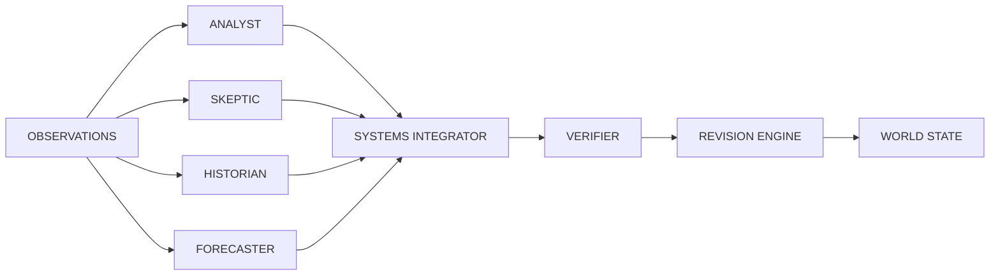

# Agent Orchestration

**Reality Engine — Agent Orchestration Document**
**Version:** 0.1.0
**Date:** November 1, 2026

This document defines the agent orchestration of Reality Engine. It covers how the Agents are orchestrated and coordinated.

---

## 1. Orchestration Overview

The Intelligence Engine uses six specialized, task-driven agents. A deterministic scheduler decides which operation is necessary.

**Agents:**

| Agent | Role |
|---|---|
| Analyst | Interpret observations, extract relationships, propose hypotheses |
| Skeptic | Find contradictions, alternative explanations, unsupported assumptions |
| Historian | Retrieve historical context, compare with current events |
| Forecaster | Generate testable predictions |
| Verifier | Check provenance, evidence, temporal consistency, schema validity |
| Systems Integrator | Coordinate proposals, update world-state projections |

---

## 2. Execution Model

Agents should be invoked when tasks require them. Do not run every agent continuously.

**Scheduler inputs:**

- Task complexity
- Uncertainty
- Novelty
- Resource cost

**Scheduler outputs:**

- Which agents to invoke.
- In what order.
- With what context.

---

## 3. Agent Interaction

---

## 4. Constraints

1. **Agents do not vote on what is true.**
2. **The Verifier should use deterministic validation wherever possible.**
3. **The Systems Integrator must not directly write authoritative world-state records.**
4. **Agents should be invoked when tasks require them.**
5. **Routine extraction should use inexpensive local models.**
6. **More capable reasoning models should be reserved for difficult interpretation and revision problems.**
