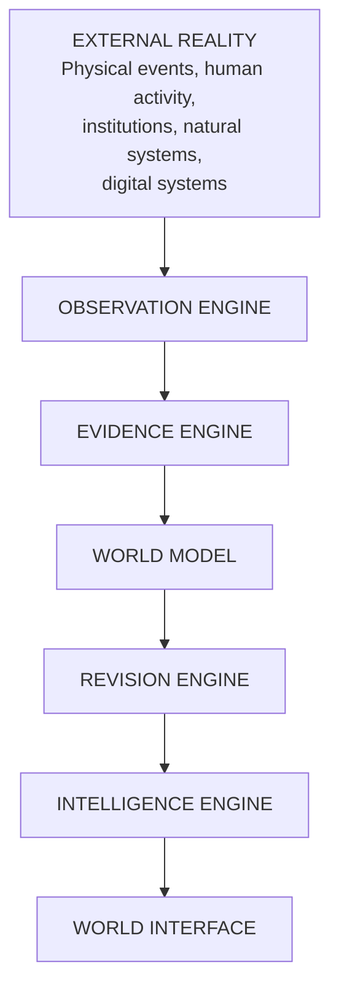

# Architecture

**Reality Engine — System Architecture Document**
**Version:** 0.1.0
**Date:** November 1, 2026

This document describes the architecture of Reality Engine. It is intended to be internally consistent with the ontology, database schema, API specification, and revision engine documentation.

---

## 1. Architectural Overview

Reality Engine is a continuously operating computational system that constructs, maintains, evaluates, and revises a global representation of the world using observations collected from heterogeneous information sources.

The architecture is organized into seven logical layers. Each layer has a distinct responsibility, and data flows downward from the external world and upward into the world model and interface.



The seven layers are:

| Layer | Name | Responsibility |
|---|---|---|
| 1 | External Reality | The environment being modeled. Conceptual only — not directly controlled or completely observed. |
| 2 | Observation Engine | Collects information from external sources. Source discovery, scheduled collection, API/RSS ingestion, data normalization, collection timestamps, source identification, duplicate detection. |
| 3 | Evidence Engine | Transforms source material into structured observations and claims. Claim extraction, entity identification, event extraction, source lineage, evidence relationships, contradiction detection, provenance preservation, evidence quality assessment. |
| 4 | World Model | Maintains the structured representation of global entities, events, conditions, and relationships. Seven domain models sharing a common ontology. |
| 5 | Revision Engine | Determines how new evidence affects existing understanding. Dependency-aware revision, contradiction analysis, temporal reconciliation, state transition validation, historical version preservation. |
| 6 | Intelligence Engine | Provides analytical capabilities. Six agents: Analyst, Skeptic, Historian, Forecaster, Verifier, Systems Integrator. |
| 7 | World Interface | Exposes the system to users. World Overview, World Explorer, Reality Timeline, Change Intelligence, Evidence Explorer, Ask Reality, Forecast Observatory, System Observatory. |

### 1.1 Scope of the Architecture

This document describes the system architecture. It does not describe:

- The detailed data model (see ONTOLOGY.md, DATABASE_SCHEMA.md).
- The revision engine in detail (see REVISION_MODEL.md).
- The API contract (see API_SPECIFICATION.md).
- The security model (see SECURITY_MODEL.md).
- The user interface (see USER_INTERFACE.md).

---

## 2. Architectural Principles

### 2.1 Modular Monolith

The initial architecture is a modular monolith. Each subsystem has an independent internal interface but shares a common application runtime. Microservices are not required for the first implementation.

Subsystem boundaries must be explicit so that components can be separated later if necessary.

### 2.2 Deterministic Governance

Language models may propose changes but must not directly control authoritative world-state transitions. The Frozen Spine provides the authorization and execution boundary.

### 2.3 Evidence Preservation

Original observations and source material must remain recoverable. The system must never allow an interpretation to overwrite its underlying observation.

### 2.4 Temporal Integrity

The system must distinguish when something happened from when it became known. Temporal queries must be precise and unambiguous.

### 2.5 Provenance

Every factual assertion must have traceable provenance. The provenance chain must be preserved through revisions.

### 2.6 Model Independence

The knowledge infrastructure must not depend on a particular commercial LLM or inference provider. All inference must pass through a common model interface.

### 2.7 Local-First

The system must be capable of running on a modern Apple Silicon workstation with approximately 48 GB unified memory. Resource-intensive tasks should be queued.

---

## 3. Component Boundaries

The system is organized into the following major subsystems:

| Subsystem | Purpose | Public Interface |
|---|---|---|
| **Core** | World model, revision, temporal logic, ontology, events | Core domain interfaces |
| **Observation** | Collection, source adapters, normalization, scheduling | SourceAdapter interface, scheduler interface |
| **Evidence** | Extraction, claims, provenance, lineage, contradiction, verification | Extraction pipeline, evidence linking, contradiction detection |
| **Intelligence** | Analyst, Skeptic, Historian, Forecaster, Verifier, Integrator | Agent contracts, agent interfaces |
| **Domains** | Domain-specific models (geopolitical, economic, etc.) | Domain-specific schemas and services |
| **Governance** | Policies, permissions, Frozen Spine, audit | Authorization boundary, audit event publishing |
| **Storage** | SQLite, documents, indexes, migrations, projections | Storage interfaces |
| **API** | Routes, schemas, services | REST API (FastAPI) |
| **Frontend** | UI components, pages, explorers, observatories | Web interface (React/TypeScript) |
| **Evaluation** | Datasets, tests, benchmarks | Test suite, benchmark runner |
| **Scripts** | Utility scripts | CLI scripts |
| **Migrations** | Database migrations | Migration runner |

### 3.1 Dependency Direction

The dependency direction is:

```text
Frontend → API → Storage → Core
        ↑          ↓
      Domains ←── Governance
              ↑
        Intelligence
        ┌────────┼────────┐
      Observation    Evidence
```

Key dependency rules:

- The core domain model must not depend on the frontend or a particular LLM provider.
- The revision engine must not depend on a particular agent implementation.
- The world model must not depend on the availability of an external cloud API.
- The intelligence engine must not write authoritative world-state records directly; it must submit proposals to the revision engine.

### 3.2 No Circular Dependencies

Circular dependencies are not permitted. The dependency graph must be acyclic.

---

## 4. Integration Points

### 4.1 External Sources

The Observation Engine integrates with external sources through a common SourceAdapter interface. Each adapter is responsible for:

- Identifying the source.
- Collecting items.
- Normalizing items.
- Persisting checkpoints.
- Reporting health status.

### 4.2 Internal Services

The system's internal services communicate through well-defined interfaces:

| Source | Destination | Mechanism |
|---|---|---|
| Observation Engine | Evidence Engine | Normalized documents |
| Evidence Engine | World Model | Extracted claims and observations with provenance |
| World Model | Revision Engine | Change notifications |
| Revision Engine | Intelligence Engine | Revision proposals |
| Intelligence Engine | Revision Engine | Validated proposals |
| Revision Engine | Storage | Atomic state updates |
| Storage | API | Data queries |
| API | Frontend | JSON responses |

### 4.3 Audit Event Publication

All significant state transitions must produce audit events. The audit event is published to the audit subsystem. It is appended to the audit ledger.

---

## 5. Failure Modes and Handling

| Component | Failure Mode | Handling |
|---|---|---|
| Source adapter | Network failure | Retry with backoff; report health status |
| Source adapter | Rate limiting | Wait and resume; report failure |
| Extraction pipeline | Extraction failure | Log, preserve original document, do not fabricate data |
| Revision validation | Temporal inconsistency | Reject proposal; record rejection reason |
| Revision validation | Provenance violation | Reject proposal; record rejection reason |
| Storage | Database error | Fail-closed; prevent data loss; alert |
| API | Unauthorized request | Return 403; log |
| Intelligence agent | Model failure | Fall back to local model or retry; do not block the pipeline |
| Infrastructure | Disk full | Fail-closed; alert |

---

## 6. Deployment Architecture

### 6.1 Development

- Local development: run the core services with a single command.
- Configuration: environment variables (see .env.example).
- Secrets: stored outside source control.

### 6.2 Production

- The system is deployed as a modular monolith.
- Background processing is handled by Python task workers.
- The API is served by FastAPI.
- The frontend is served as static assets.

### 6.3 Scaling

The system is designed to scale vertically before horizontally. If the workload requires distribution, introduce services based on measured requirements:

- SQLite → PostgreSQL for concurrent transactional workloads
- Graph projections → dedicated graph storage
- DuckDB for analytical processing
- Specialized vector storage
- Message queues
- Distributed ingestion workers

No migration should be performed simply because a technology is fashionable.

---

## 7. Data Flow Summary


1. **Collect** — The Observation Engine gathers documents from sources.
2. **Normalize** — Documents are normalized into a standard format.
3. **Extract** — The Evidence Engine extracts observations and claims.
4. **Link** — Claims are linked to evidence and source passages.
5. **Validate** — The Evidence Engine validates schema, provenance, and temporal consistency.
6. **Store** — The World Model stores the verified information.
7. **Analyze** — The Intelligence Engine analyzes changes.
8. **Revise** — The Revision Engine generates and validates revision proposals.
9. **Audit** — Audit events are recorded.

---

## 8. Key Architectural Decisions

The following decisions are made in this document and recorded in ARCHITECTURE_DECISIONS.md:

| Decision | Value |
|---|---|
| Architecture | Modular monolith |
| Storage | SQLite WAL |
| Full-text search | FTS5 |
| Validation | Pydantic |
| API | FastAPI |
| Interface | React and TypeScript |
| Inference | Ollama / llama.cpp |
| Embedding | Local embedding models |
| Deployment | Local-first |
| Governance | Frozen Spine |

---

## 9. Summary

Reality Engine is a seven-layer system:

1. External Reality (conceptual)
2. Observation Engine
3. Evidence Engine
4. World Model
5. Revision Engine
6. Intelligence Engine
7. World Interface

The system is organized as a modular monolith with explicit subsystem boundaries. Deterministic governance (Frozen Spine) controls all state transitions. The architecture is local-first and model-independent. All significant state transitions produce audit events.
