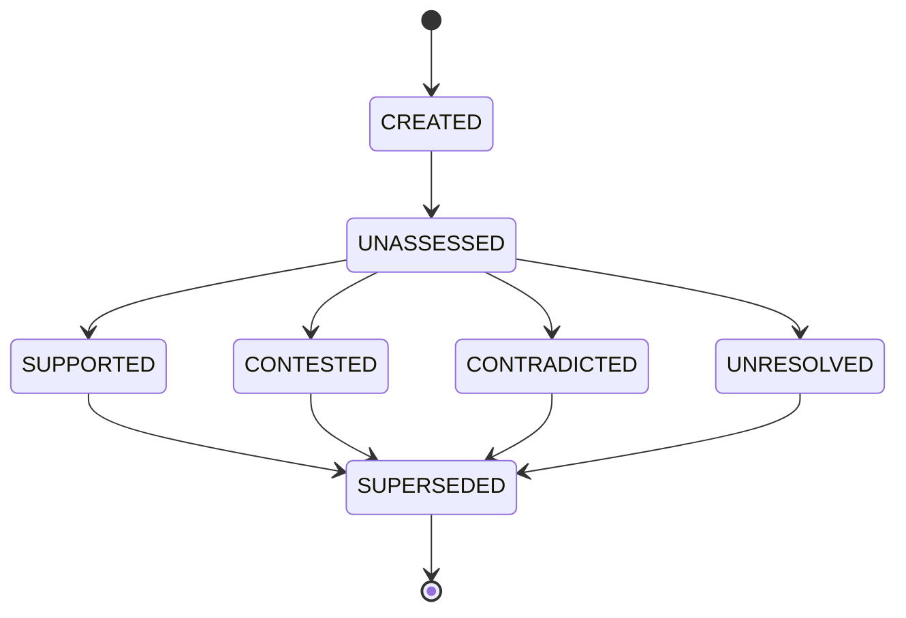

# Claim Model

**Reality Engine — Claim Model Document**
**Version:** 0.1.0
**Date:** November 1, 2026

This document defines the claim model of Reality Engine. It defines all claims, their fields, constraints, and temporal semantics.

---

## 1. Claim Definition

A claim is an assertion about the world. A claim is a factual statement that can be supported or challenged by evidence. Claims have types that determine how they are evaluated.

**Example:**

- "Inflation is increasing in a particular economy."
- "Country X announced policy Y."
- "Policy Y will increase inflation."

Claims are stored in the `claims` table. They are distinct from observations (which are measurements) and from hypotheses (which are speculative explanations).

---

## 2. Claim Fields

| Field | Type | Required | Description |
|---|---|---|---|
| id | string | Yes | Claim identifier |
| subject_id | string | Yes | Foreign key to Entity (subject of the claim) |
| predicate | string | Yes | Predicate (relationship type) |
| object_value | string | Yes | The claim's object |
| claim_type | string | Yes | Claim type |
| domain_id | string | Yes | Foreign key to Domain |
| valid_from | timestamp | Yes | When the claim applies |
| valid_to | timestamp or null | No | When the claim ceased to apply |
| recorded_at | timestamp | Yes | When the system recorded it |
| status | string | Yes | Evidence status |
| revision_number | integer | Yes | Revision counter |
| created_at | timestamp | Yes | Creation timestamp |

**claim_type values:**

| Type | Description |
|---|---|
| FACTUAL | Assertion about an event or condition |
| REPORTED | Assertion attributed to another source |
| INTERPRETIVE | Explanation or interpretation |
| PREDICTIVE | Assertion about a future outcome |
| NORMATIVE | Value judgment or recommendation |
| HYPOTHETICAL | Conditional proposition |
| QUANTITATIVE | Assertion involving measurable values |

**status values:**

| Value | Meaning |
|---|---|
| UNASSESSED | Not yet evaluated |
| SUPPORTED | Evidence supports the claim |
| PARTIALLY_SUPPORTED | Some evidence supports, some challenges |
| CONTESTED | Competing claims exist |
| CONTRADICTED | Evidence directly challenges the claim |
| UNRESOLVED | Insufficient evidence to decide |
| SUPERSEDED | Replaced by a newer version |
| WITHDRAWN | Explicitly withdrawn |

**Constraints:**

- `subject_id` must reference an existing Entity.
- `domain_id` must reference an existing Domain.
- `valid_from` must be less than or equal to `valid_to` (if `valid_to` is set).
- `recorded_at` must be greater than or equal to `valid_from`.
- `status` must be one of the values listed above.
- `revision_number` is incremented on each revision.

---

## 3. Claim Structure

A claim is structured as:

- **Subject:** The entity the claim is about.
- **Predicate:** The relationship type.
- **Object:** The object of the claim.
- **Claim type:** How the claim should be evaluated.
- **Domain:** The domain it belongs to.
- **Valid time:** When the claim applies.
- **Status:** The current evidence status.

**Example:**

```json
{
  "id": "claim_000184",
  "subject_id": "entity_001",
  "predicate": "has_policy",
  "object_value": "policy_004",
  "claim_type": "FACTUAL",
  "domain_id": "geopolitical",
  "valid_from": "2026-10-15T00:00:00Z",
  "valid_to": null,
  "recorded_at": "2026-10-16T10:00:00Z",
  "status": "SUPPORTED",
  "revision_number": 3,
  "created_at": "2026-10-16T10:00:00Z"
}
```

---

## 4. Claim Types and Evaluation

| Claim Type | Evaluation Rule |
|---|---|
| FACTUAL | Evaluated using direct measurements and reports |
| REPORTED | Evaluated using evidence about the source |
| INTERPRETIVE | Evaluated using evidence about the interpretation |
| PREDICTIVE | Evaluated against actual outcomes after the horizon |
| NORMATIVE | Evaluated using evidence about preferences and values |
| HYPOTHETICAL | Evaluated conditionally |
| QUANTITATIVE | Evaluated using numeric measurements |

**Constraint:** A prediction should not be evaluated using the same rules as a directly recorded measurement.

---

## 5. Claim Relationships

Claims are related to other claims through evidence links:

| Relationship | Meaning |
|---|---|
| SUPPORTS | Evidence supports the claim |
| CONTRADICTS | Evidence contradicts the claim |
| QUALIFIES | Evidence qualifies the claim |
| DERIVED_FROM | Evidence is derived from the claim |
| REPEATS | Evidence repeats the claim |
| ATTRIBUTED_TO | Evidence is attributed to the claim |
| SUPERSEDES | Evidence supersedes the claim |
| CORROBORATES | Evidence corroborates the claim |

---

## 6. Claim Examples

**Factual Claim:**

```json
{
  "id": "claim_000001",
  "subject_id": "entity_000001",
  "predicate": "has_policy",
  "object_value": "policy_001",
  "claim_type": "FACTUAL",
  "domain_id": "geopolitical",
  "valid_from": "2026-10-15T00:00:00Z",
  "valid_to": null,
  "recorded_at": "2026-10-16T10:00:00Z",
  "status": "SUPPORTED",
  "revision_number": 1,
  "created_at": "2026-10-16T10:00:00Z"
}
```

**Predictive Claim:**

```json
{
  "id": "claim_000002",
  "subject_id": "entity_000001",
  "predicate": "will_increase",
  "object_value": "inflation",
  "claim_type": "PREDICTIVE",
  "domain_id": "economic",
  "valid_from": "2026-10-15T00:00:00Z",
  "valid_to": "2026-12-15T00:00:00Z",
  "recorded_at": "2026-10-15T10:00:00Z",
  "status": "UNRESOLVED",
  "revision_number": 1,
  "created_at": "2026-10-15T10:00:00Z"
}
```

**Quantitative Claim:**

```json
{
  "id": "claim_000003",
  "subject_id": "entity_000001",
  "predicate": "has_inflation_rate",
  "object_value": "3.2",
  "claim_type": "QUANTITATIVE",
  "domain_id": "economic",
  "valid_from": "2026-10-15T00:00:00Z",
  "valid_to": null,
  "recorded_at": "2026-10-16T10:00:00Z",
  "status": "SUPPORTED",
  "revision_number": 1,
  "created_at": "2026-10-16T10:00:00Z"
}
```

---

## 7. Claim Lifecycle



| State | Description |
|---|---|
| CREATED | The claim has been created |
| UNASSESSED | The claim has not been evaluated |
| SUPPORTED | Evidence supports the claim |
| CONTESTED | Competing claims exist |
| CONTRADICTED | Evidence directly challenges the claim |
| UNRESOLVED | Insufficient evidence to decide |
| SUPERSEDED | Replaced by a newer version |

---

## 8. References

- ONTOLOGY.md — common ontology definitions
- OBSERVATION_MODEL.md — observation definitions
- EVIDENCE_MODEL.md — evidence definitions
- TEMPORAL_MODEL.md — bitemporal semantics
- BELIEF_REVISION.md — how claims are revised
- REVISION_STATE_MACHINE.md — how revisions interact with claims
