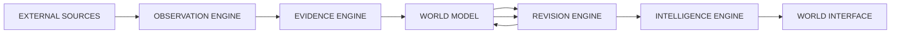
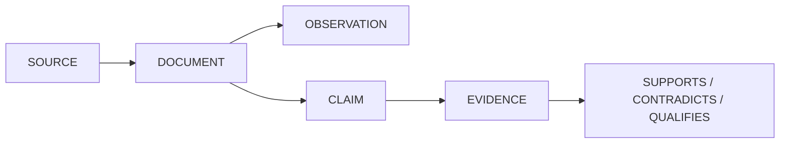
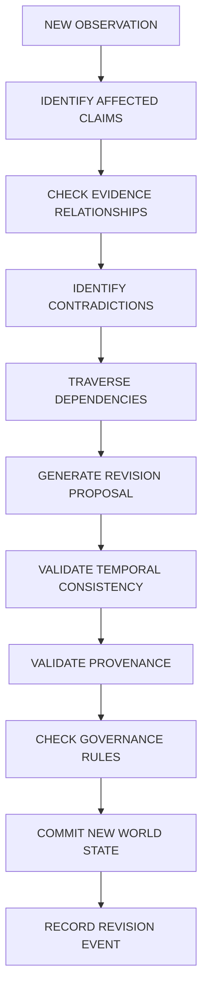

# Data Flow

**Reality Engine — Data Flow Document**
**Version:** 0.1.0
**Date:** November 1, 2026

This document describes how data moves through the system. It covers the end-to-end data flow from external sources through the world model to the user interface, and explains where data is stored, transformed, and validated at each stage.

---

## 1. Data Flow Overview

Reality Engine is a continuously operating system. Data flows through the system in a pipeline with feedback loops. The pipeline stages are:

1. **External sources** — information enters the system.
2. **Observation Engine** — sources are collected and documents are normalized.
3. **Evidence Engine** — documents are extracted into observations and claims; evidence is linked.
4. **World Model** — verified information is stored and organized.
5. **Revision Engine** — changes to the world model are proposed and validated.
6. **Intelligence Engine** — the model is analyzed and revisions are proposed.
7. **World Interface** — the user explores the model.



The key characteristics of the data flow:

- **One-way data flow** from external sources through the pipeline.
- **Feedback loops** — the world model influences the revision engine and intelligence agents.
- **Validation gates** — data is validated before it enters the world model or affects it.
- **Preservation of originals** — the source material is never overwritten.
- **Audit trail** — all significant state transitions produce audit events.

---

## 2. Source-to-Stored-Data Flow

### Stage 1: External Sources

External information enters the system from sources:

| Domain | Source Types |
|---|---|
| News and global events | GDELT, RSS feeds, government press releases, international organization announcements |
| Economics | FRED, World Bank, IMF, OECD, national statistical agencies, central bank publications |
| Science | Crossref, OpenAlex, arXiv, PubMed |
| Environment | NASA, NOAA, Copernicus, national meteorological agencies |
| Technology | GitHub API, public software release feeds, patent databases |
| Geopolitical and institutional | United Nations, World Trade Organization, government publications, treaty databases |

The observation engine must not assume that any source is completely trustworthy. Every source is treated as untrusted input.

### Stage 2: Collection

The Observation Engine collects items from sources through Source Adapters.

**SourceAdapter interface:**

```python
class SourceAdapter:
    def identify(self) -> SourceIdentity:
        ...

    def collect(self, cursor=None) -> CollectionBatch:
        ...

    def normalize(self, raw_item) -> NormalizedDocument:
        ...

    def checkpoint(self) -> CollectionCheckpoint:
        ...

    def health(self) -> AdapterHealth:
        ...
```

**Collection stage responsibilities:**

- Pagination.
- Incremental collection.
- Retry handling.
- Rate limiting.
- Duplicate detection.
- Failure reporting.
- Source-specific metadata.
- Collection checkpoint persistence.

### Stage 3: Document Identity

Documents receive stable identities:

- **Document ID** — a unique identifier.
- **Source ID** — the source that published the document.
- **Source-native identifier** — the identifier used by the source.
- **Canonical URL** — the canonical location of the document.

A **content hash** is generated from the document content. Identical content retrieved through multiple URLs is recognized without discarding the individual source records.

### Stage 4: Normalization

The Normalization component converts source-specific formats into normalized documents:

```python
class Normalizer:
    def normalize(self, raw_item, source_id) -> NormalizedDocument:
        ...
```

The normalized document includes:

- Document ID
- Source ID
- Source-native identifier
- Canonical URL
- Content hash
- Publication timestamp
- Collection timestamp
- Original language
- Content type
- Original content reference
- Processing status
- Source update frequency
- Domain importance
- Historical reliability
- Information freshness
- Resource cost
- Unresolved knowledge gaps

**Critical rule:** Normalization must not lose metadata.

### Stage 5: Extraction

The Evidence Engine extracts observations and claims from documents.

**Claim types:**

| Type | Definition |
|---|---|
| Factual | Assertion about an event or condition |
| Reported | Assertion attributed to another source |
| Interpretive | Explanation or interpretation |
| Predictive | Assertion about a future outcome |
| Normative | Value judgment or recommendation |
| Hypothetical | Conditional proposition |
| Quantitative | Assertion involving measurable values |

**Extraction stage responsibilities:**

- Extract candidate claims from documents.
- Classify claims by type.
- Resolve entities against the registry.
- Link claims to source passages.
- Produce evidence links (SUPPORTS, CONTRADICTS, QUALIFIES, DERIVED_FROM, REPEATS, ATTRIBUTED_TO, SUPERSEDES, CORROBORATES).

**Critical rule:** Every claim must be traceable to a source passage.

### Stage 6: Evidence Linking

Claims are linked to evidence:



Evidence links include:

- SUPPORTS
- CONTRADICTS
- QUALIFIES
- DERIVED_FROM
- REPEATS
- ATTRIBUTED_TO
- SUPERSEDES
- CORROBORATES

Every relationship must contain its own provenance and, where applicable, an explanation of the inference.

### Stage 7: Validation

Before information enters the world model, it passes through validation:

| Validation Type | What is checked |
|---|---|
| Schema | Required fields, types, constraints |
| Provenance | Claim is traceable to a source passage |
| Temporal consistency | Valid time and recorded time are consistent |
| Source independence | Duplicates are deduplicated; shared origins flagged |
| Source quality | Source authority and reliability metadata present |

### Stage 8: Storage (World Model)

The world model stores the verified information:

| Table | Stores |
|---|---|
| sources | Source identities and characteristics |
| documents | Original collected material |
| observations | Extracted or measured observations |
| claims | Normalized assertions |
| evidence_links | Support and contradiction relationships |
| entities | Countries, organizations, people, systems |
| entity_aliases | Alternate names for entities |
| events | Occurrences in the world |
| relationships | Connections between entities |
| hypotheses | Explanatory models |
| forecasts | Predictions and evaluation conditions |
| world_states | Versioned state snapshots |
| revision_events | Every proposed and accepted revision |
| dependencies | Relationships between conclusions |
| source_lineage | Shared origins and information propagation |
| audit_events | Audit trail of significant operations |

### Stage 9: Intelligence Analysis

The Intelligence Engine analyzes the world model:

| Agent | Responsibility |
|---|---|
| Analyst | Extract meaning, identify relationships, propose interpretations and hypotheses |
| Skeptic | Search for contradictions, missing evidence, alternative explanations |
| Historian | Connect current events to historical precedents |
| Forecaster | Generate testable predictions |
| Verifier | Check provenance, evidence relationships, temporal consistency, schema validity |
| Systems Integrator | Coordinate revision proposals, update affected projections |

### Stage 10: Revision

The Revision Engine maintains the evolving model:



Revision outcomes:

| Outcome | Meaning |
|---|---|
| NEW_INFORMATION | New evidence requiring review |
| SUPPORTED | Existing claim is supported |
| PARTIALLY_SUPPORTED | Some evidence supports, some challenges |
| CHALLENGED | Existing claim is challenged |
| CONTRADICTED | Existing claim is contradicted |
| SUPERSEDED | Replaced by a newer version |
| WITHDRAWN | Explicitly withdrawn |
| UNRESOLVED | Cannot be resolved |
| NO_CHANGE | No effect on current understanding |

### Stage 11: Audit

All significant state transitions produce audit events.

**Audit event fields:**

| Field | Meaning |
|---|---|
| id | Unique identifier |
| event_type | Source_REGISTERED, DOCUMENT_COLLECTED, CLAIM_CREATED, REVISION_PROPOSED, REVISION_VALIDATED, REVISION_REJECTED, WORLD_STATE_UPDATED, FORECAST_CREATED, FORECAST_EVALUATED, SCHEMA_MIGRATED |
| actor_type | The actor performing the operation |
| actor_id | The actor's identifier |
| object_type | The object being operated on |
| object_id | The object's identifier |
| previous_hash | Hash of the state before the change |
| event_hash | Hash of the event |
| payload_reference | Reference to the payload |
| created_at | When the event was recorded |

Audit events are **append-only**. Corrections require new events. A previous event must not be silently rewritten.

### Stage 12: User Interface

The World Interface exposes the system to users:

| Interface | Purpose |
|---|---|
| World Overview | Continuously updated global overview |
| World Explorer | Interactive map and graph |
| Reality Timeline | Historical reconstruction |
| Change Intelligence | Show changes rather than new documents |
| Evidence Explorer | Inspect evidence |
| Ask Reality | Natural-language queries |
| Forecast Observatory | Forecast performance |
| System Observatory | Operational health |

---

## 3. Data Ownership

| Data Type | Owner |
|---|---|
| External source documents | Observation Engine |
| Normalized documents | Observation Engine |
| Extracted observations and claims | Evidence Engine |
| Evidence links and relationships | Evidence Engine |
| World-state versions | World Model |
| Revision events and dependencies | Revision Engine |
| Agent proposals and analysis | Intelligence Engine |
| Audit events | Governance (Audit) |
| Query results | API |

---

## 4. Data Lineage

The complete provenance chain is:

```text
SOURCE → DOCUMENT → OBSERVATION → CLAIM → EVIDENCE → UNDERSTANDING → REVISION
```

Every claim must be traceable to:

1. The original source.
2. The specific source document.
3. The relevant passage (URL, page, paragraph).
4. The extraction timestamp.
5. The extraction model and version.
6. The extraction prompt version.
7. The validation status.

---

## 5. Temporal Data Flow

### Valid Time vs. Transaction Time

Every time-sensitive object has:

| Field | Meaning |
|---|---|
| valid_from | When the information applies to the external world |
| valid_to | When the information ceased to apply |
| recorded_at | When the system recorded the information |
| superseded_at | When the system replaced the information |

### Historical Reconstruction Queries

The system supports two distinct queries:

| Query | Meaning |
|---|---|
| Historical knowledge | What did the system understand about the world at a particular historical date? (Uses only information available at that time.) |
| Current understanding of the past | What does the system currently understand about what was true at that historical date? (Uses all available current information.) |

These queries must produce distinct results.

---

## 6. Data Transformation Rules

### Rule 1: Source Material Is Immutable

- Original documents are never overwritten.
- If an article is corrected, both the original and corrected versions are preserved.
- If an interpretation changes, the earlier interpretation is preserved and explained.

### Rule 2: Evidence Is Never Silently Destroyed

- Evidence is preserved even if a claim is retracted.
- Contradictory evidence is preserved and linked.
- The evidence ledger is append-only.

### Rule 3: Interpretation Is Versioned

- Interpretations have versions.
- Each version is preserved.
- The reason for a change is recorded.

### Rule 4: Claims Are Linked to Evidence

- A claim cannot enter the verified factual state without provenance.
- A claim without provenance may exist as an explicitly unverified hypothesis.

### Rule 5: Dependencies Are Explicit

- Dependency relationships are explicit and traversable.
- The system does not infer dependencies implicitly.

### Rule 6: Revisions Are Atomic

- A revision commit either completes fully or fails entirely.
- All changes from a revision proposal are committed atomically.

### Rule 7: Revising State Preserves History

- Earlier versions of the world state remain recoverable.
- A historical record must never be silently modified to match current understanding.

---

## 7. Data Flow Summary

```mermaid
flowchart LR
    EX["EXTERNAL INFORMATION SOURCES"] --> OE["OBSERVATION ENGINE"]
    OE --> NE["DOCUMENT NORMALIZATION"]
    NE --> EVID["EVIDENCE ENGINE"]
    EVID --> CE["CLAIM EXTRACTION"]
    CE --> ER["ENTITY RESOLUTION"]
    ER --> PE["PROVENANCE AND LINEAGE"]
    PE --> WM["WORLD MODEL"]
    WM --> RE["REVISION ENGINE"]
    RE --> DV["DETERMINISTIC VALIDATION"]
    DV --> AWS["ACCEPTED WORLD STATE"]
    AWS --> IE["INTELLIGENCE ENGINE"]
    IE --> UI["USER INTERFACE"]
    IE --> RE2["REVISION ENGINE"]
    RE2 --> DV
```



1. **Collect** — sources are gathered.
2. **Normalize** — documents are normalized.
3. **Extract** — observations and claims are extracted.
4. **Link** — claims are linked to evidence and source passages.
5. **Validate** — schema, provenance, temporal consistency, source independence.
6. **Store** — verified information enters the world model.
7. **Analyze** — the intelligence engine analyzes the model.
8. **Revise** — the revision engine generates and validates proposals.
9. **Audit** — audit events are recorded.
10. **Interface** — users explore the model.
