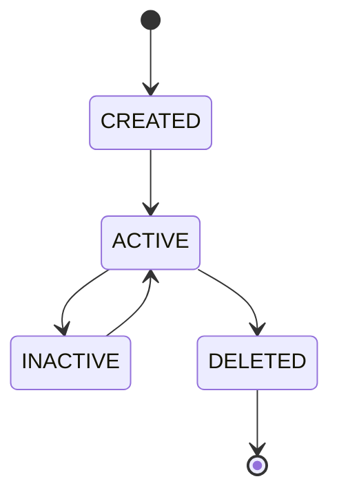

# Entity Model

**Reality Engine — Entity Model Document**
**Version:** 0.1.0
**Date:** November 1, 2026

This document defines the entity model of Reality Engine. It defines all entities, their fields, identifiers, constraints, and resolution rules.

---

## 1. Entity Definition

An entity is an identifiable object in the world. Entities represent the stable objects around which the world model is organized.

**Examples:**

- Countries (Country X, Country Y)
- Governments (Government of Country X)
- Companies (TechnologyCorp)
- Institutions (World Bank, IMF)
- People (Individual names)
- Geographic regions (Sclerosis Creek, Northeast Asia)
- Scientific organizations (CERN, NASA)
- Infrastructure systems (Grid A, Port B)
- Technologies (Battery technology, 5G)

---

## 2. Entity Identity

Entities have **stable internal identifiers**. External identifiers should be stored as aliases rather than replacing internal identity.

### 2.1 Stable Internal Identifier

Every entity has a unique internal identifier:

```
entity_000001
entity_000002
...
```

The internal identifier is used as the primary key in all tables and as the reference in all queries. It is never reused.

### 2.2 External Identifiers

External identifiers are stored as aliases. For example, Country X might be known as "ABC" in one source, "XYZ" in another, and "The Republic" in a third. Each of these is stored as an alias, and the entity is represented once internally.

**Identity rules:**

1. Every entity must have a stable internal identifier.
2. External identifiers must be stored as aliases.
3. An entity is not a different object if it is known by a different name.
4. Unambiguous identity resolution must remain unresolved until sufficient evidence exists.

---

## 3. Entity Types

Entities are typed to support domain-specific modeling.

| Type | Description | Example |
|---|---|---|
| COUNTRY | A country or nation-state | Country X |
| GOVERNMENT | A government | Government of Country X |
| ORGANIZATION | An organization | World Bank |
| PERSON | A person | Individual name |
| REGION | A geographic region | Northeast Asia |
| INSTITUTION | An institution | IMF |
| SCIENTIFIC_ORGANIZATION | A scientific organization | CERN |
| INFRASTRUCTURE_SYSTEM | An infrastructure system | Grid A |
| TECHNOLOGY | A technology | Battery technology |

**Constraints:**

- `entity_type` must be one of the values listed above.
- `canonical_name` must be unique per domain.

---

## 4. Entity Fields

| Field | Type | Required | Description |
|---|---|---|---|
| id | string | Yes | Unique identifier (e.g., `entity_000001`) |
| canonical_name | string | Yes | Canonical name of the entity |
| entity_type | string | Yes | Type of entity |
| domain_id | string | Yes | Foreign key to Domain |
| created_at | timestamp | Yes | Creation timestamp |
| updated_at | timestamp | Yes | Update timestamp |
| status | string | Yes | Entity status |

**Entity status values:**

| Value | Meaning |
|---|---|
| ACTIVE | The entity is currently active |
| INACTIVE | The entity is inactive |
| DELETED | The entity has been deleted (soft delete) |

**Constraints:**

- `id` must be unique.
- `canonical_name` must be unique per domain.
- `entity_type` must be one of the values listed above.
- `domain_id` must reference an existing Domain.

---

## 5. Entity Aliases

Entity aliases represent alternate names for an entity.

**Alias fields:**

| Field | Type | Required | Description |
|---|---|---|---|
| id | string | Yes | Unique identifier |
| entity_id | string | Yes | Foreign key to Entity |
| alias | string | Yes | The alias |
| language | string | Yes | Language (ISO 639-1) |
| source_id | string | Yes | Foreign key to Source |
| valid_from | timestamp | Yes | When the alias applies |
| valid_to | timestamp or null | No | When the alias ceased to apply |
| created_at | timestamp | Yes | Creation timestamp |

**Alias rules:**

1. An alias must reference an existing Entity.
2. An alias must reference an existing Source.
3. `valid_from` must be less than or equal to `valid_to` (if `valid_to` is set).
4. An entity can have multiple aliases.
5. An alias can be marked as obsolete by setting `valid_to`.

**Language format:**

- Language codes follow ISO 639-1 (e.g., "en" for English, "fr" for French, "zh" for Chinese).

---

## 6. Entity Resolution

Entity resolution is the process of identifying the entity that a reference in a document corresponds to.

### 6.1 Resolution Process

1. **Extract reference:** Extract the name from the document.
2. **Match against registry:** Match against existing entity canonical names and aliases.
3. **Disambiguation:** If multiple entities match, request additional evidence.
4. **Create new entity:** If no match, create a new entity.
5. **Resolve confidence:** Record the confidence and evidence for the resolution.

### 6.2 Resolution Triggers

Entity resolution is triggered by:

- A name appearing in a document.
- An organization name appearing in a document.
- A person's name appearing in a document.
- A geographic region appearing in a document.
- A technology appearing in a document.

### 6.3 Resolution Decision Factors

Entity resolution considers:

- Name similarity.
- Context in the document.
- Domain.
- Source independence.
- Temporal validity.

### 6.4 Ambiguity Handling

Ambiguous identity resolution must remain **unresolved** until sufficient evidence exists. Do not guess.

---

## 7. Entity Lifecycle

An entity follows this lifecycle:



| State | Description |
|---|---|
| CREATED | The entity has been created |
| ACTIVE | The entity is active |
| INACTIVE | The entity is inactive |
| DELETED | The entity has been deleted (soft delete) |

### 7.1 State Transitions

| From | To | Constraints |
|---|---|---|
| CREATED | ACTIVE | No constraints |
| ACTIVE | INACTIVE | Must preserve all historical data |
| INACTIVE | ACTIVE | Historical data preserved |
| ACTIVE | DELETED | Soft delete; historical data preserved |

---

## 8. Entity Relationships

Entities are connected by relationships. The relationship model is defined in RELATIONSHIP_MODEL.md.

### 8.1 Relationship Types

| Type | Description |
|---|---|
| LOCATED_IN | Entity is located in a place |
| MEMBER_OF | Entity is a member of a group |
| OWNS | Entity owns something |
| CONTROLS | Entity controls something |
| PARTICIPATES_IN | Entity participates in an event |
| ANNOUNCED | Entity announced something |
| AFFECTS | Entity affects something |
| SUPPORTS | Entity supports something |
| CONTRADICTS | Entity contradicts something |
| PRECEDES | Entity precedes something |
| FOLLOWS | Entity follows something |
| DEPENDS_ON | Entity depends on something |
| CORRELATES_WITH | Entity correlates with something |
| CAUSES | Entity causes something |
| CAUSED_BY_HYPOTHESIS | Entity is caused by a hypothesis |
| PREDICTS | Entity predicts something |
| DERIVED_FROM | Entity is derived from something |

### 8.2 Relationship Constraints

- Causal relationships require stronger evidence and explicit methodological justification than ordinary associations.
- The system must distinguish correlation from causation.

---

## 9. Temporal Constraints

| Field | Constraint |
|---|---|
| valid_from | Must be less than or equal to valid_to (if valid_to is set) |
| recorded_at | Must be greater than or equal to valid_from |
| valid_from | All timestamps in UTC |

---

## 10. JSON Schema Example

**Entity:**

```json
{
  "id": "entity_000001",
  "canonical_name": "Country X",
  "entity_type": "COUNTRY",
  "domain_id": "geopolitical",
  "created_at": "2026-10-16T09:00:00Z",
  "updated_at": "2026-10-16T09:00:00Z",
  "status": "ACTIVE"
}
```

**Entity Alias:**

```json
{
  "id": "alias_000001",
  "entity_id": "entity_000001",
  "alias": "The Republic",
  "language": "en",
  "source_id": "src_000001",
  "valid_from": "2026-10-16T09:00:00Z",
  "valid_to": null,
  "created_at": "2026-10-16T09:00:00Z"
}
```

---

## 11. Entity Examples

**Country Entity:**

```json
{
  "id": "entity_000001",
  "canonical_name": "Country X",
  "entity_type": "COUNTRY",
  "domain_id": "geopolitical",
  "created_at": "2026-10-16T09:00:00Z",
  "updated_at": "2026-10-16T09:00:00Z",
  "status": "ACTIVE"
}
```

**Government Entity:**

```json
{
  "id": "entity_000002",
  "canonical_name": "Government of Country X",
  "entity_type": "GOVERNMENT",
  "domain_id": "geopolitical",
  "created_at": "2026-10-16T09:00:00Z",
  "updated_at": "2026-10-16T09:00:00Z",
  "status": "ACTIVE"
}
```

**Company Entity:**

```json
{
  "id": "entity_000003",
  "canonical_name": "TechnologyCorp",
  "entity_type": "ORGANIZATION",
  "domain_id": "technological",
  "created_at": "2026-10-16T09:00:00Z",
  "updated_at": "2026-10-16T09:00:00Z",
  "status": "ACTIVE"
}
```

**Person Entity:**

```json
{
  "id": "entity_000004",
  "canonical_name": "John Smith",
  "entity_type": "PERSON",
  "domain_id": "geopolitical",
  "created_at": "2026-10-16T09:00:00Z",
  "updated_at": "2026-10-16T09:00:00Z",
  "status": "ACTIVE"
}
```

**Region Entity:**

```json
{
  "id": "entity_000005",
  "canonical_name": "Northeast Asia",
  "entity_type": "REGION",
  "domain_id": "geopolitical",
  "created_at": "2026-10-16T09:00:00Z",
  "updated_at": "2026-10-16T09:00:00Z",
  "status": "ACTIVE"
}
```

**Infrastructure System Entity:**

```json
{
  "id": "entity_000006",
  "canonical_name": "Grid A",
  "entity_type": "INFRASTRUCTURE_SYSTEM",
  "domain_id": "infrastructure",
  "created_at": "2026-10-16T09:00:00Z",
  "updated_at": "2026-10-16T09:00:00Z",
  "status": "ACTIVE"
}
```

---

## 12. Entity Resolution Test Cases

| Test Case | Description | Expected Result |
|---|---|---|
| Same name, different entity | Two entities with the same name in different domains | Different entities (resolved by domain) |
| Name change | A government renamed | One entity with alias history |
| Abbreviation | "US" refers to "United States" | Same entity, alias added |
| Translation | "France" vs "France" (French) | Same entity, alias added |
| Duplicate identification | Two sources use different names for the same entity | One entity with multiple aliases |

---

## 13. Summary

- Entities have stable internal identifiers.
- External identifiers are stored as aliases.
- Entities are typed.
- Entities are connected by typed relationships.
- Entity resolution is ambiguous until sufficient evidence exists.
- Entity lifecycles are tracked.
- All temporal constraints are enforced.
- The entity model is shared across domains.
