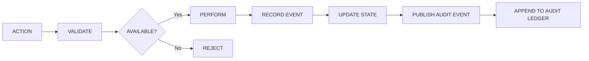

# Event Architecture

**Reality Engine — Event Architecture Document**
**Version:** 0.1.0
**Date:** November 1, 2026

This document describes the event architecture of Reality Engine. It covers the event types, event immutability, replay, and reproducibility.

---

## 1. Event Types

The system records events for all significant operations. Every event has a stable type, a producer, and payloads that reference the affected objects.

### 1.1 Core Event Types

| Event Type | Description |
|---|---|
| SOURCE_REGISTERED | A new source has been registered |
| DOCUMENT_COLLECTED | A document has been collected from a source |
| DOCUMENT_UPDATED | A document has been updated or reprocessed |
| OBSERVATION_EXTRACTED | An observation has been extracted from a document |
| CLAIM_CREATED | A claim has been created |
| CLAIM_SUPPORTED | A claim has been supported by evidence |
| CLAIM_CHALLENGED | A claim has been challenged by evidence |
| ENTITY_CREATED | An entity has been created |
| ENTITY_RESOLVED | An entity has been resolved |
| RELATIONSHIP_CREATED | A relationship has been created |
| HYPOTHESIS_CREATED | A hypothesis has been created |
| REVISION_PROPOSED | A revision proposal has been generated |
| REVISION_VALIDATED | A revision proposal has been validated |
| REVISION_REJECTED | A revision proposal has been rejected |
| WORLD_STATE_UPDATED | The world state has been updated |
| FORECAST_CREATED | A forecast has been created |
| FORECAST_EVALUATED | A forecast has been evaluated |
| SCHEMA_MIGRATED | The database schema has been migrated |

### 1.2 Event Payload Fields

Every event includes:

| Field | Meaning |
|---|---|
| id | Unique event identifier |
| event_type | The type of event |
| actor_type | The actor performing the operation (e.g., SYSTEM, AGENT, USER) |
| actor_id | The actor's identifier |
| object_type | The object being operated on |
| object_id | The object's identifier |
| previous_hash | Hash of the state before the change (for state-transition events) |
| event_hash | Hash of the event |
| payload_reference | Reference to the payload |
| created_at | When the event was recorded |

### 1.3 Revision Events

Revision events are recorded for every revision proposal and revision commit:

| Field | Meaning |
|---|---|
| revision_event_id | The revision event identifier |
| trigger_observation_id | The observation that triggered the revision |
| previous_state_id | The state before the revision |
| resulting_state_id | The state after the revision |
| revision_type | The outcome type |
| proposal_reference | Reference to the proposal |
| validation_result | The validation result |
| created_at | When the revision was recorded |

---

## 2. Event Immutability

**Events must be append-only.**

Rules:

1. A previous event must not be silently rewritten.
2. Corrections require new events.
3. The audit ledger is append-only.
4. Events are never deleted.
5. If an error is discovered in an earlier event, a corrective event is recorded that references the original event.

### Correctness of Immutability

The system must support verification of event immutability:

- Each event has a hash that can be verified against its payload.
- The previous hash links events into a chain.
- A revision event includes the previous state hash and the resulting state hash.

---

## 3. Replay

The system should support rebuilding derived world-state projections from recorded events.

### Replay Requirements

1. **Replay of accepted history:** The recorded events are replayed in order to reconstruct the accepted world state.
2. **Versioned interpretation logic:** Replay must account for versioned interpretation logic. If an extraction or inference model changes, the system must distinguish:
   - Replaying the original accepted history (exact).
   - Reprocessing source material with a newer methodology (not exact).
3. **Divergence tracking:** When a projection is rebuilt, the system must record whether the result is an exact replay or a reprocessed version.

---

## 4. Reproducibility

The system must support reproducibility of significant conclusions and revisions.

### Reproducibility Requirements

1. **Model configuration:** The model identifier, model version, prompt version, and schema version must be recorded.
2. **Processing version:** The software version must be recorded.
3. **Original outputs:** The system must preserve original model outputs and distinguish reproducibility from deterministic replay.
4. **Exact reproduction:** Exact reproduction may not always be possible with nondeterministic model inference.

### Reproducibility Fields

| Field | Meaning |
|---|---|
| model_id | The model identifier |
| model_version | The model version |
| prompt_version | The prompt version |
| schema_version | The schema version |
| software_version | The software version |
| original_output | The original model output |
| reproducibility_status | EXACT, APPROXIMATE, or NOT_REPRODUCIBLE |

---

## 5. Audit Architecture

### 5.1 Audit Event Flow



### 5.2 Audit Event Storage

Audit events are stored in the `audit_events` table:

```sql
CREATE TABLE audit_events (
    id TEXT PRIMARY KEY,
    event_type TEXT NOT NULL,
    actor_type TEXT NOT NULL,
    actor_id TEXT NOT NULL,
    object_type TEXT NOT NULL,
    object_id TEXT NOT NULL,
    previous_hash TEXT,
    event_hash TEXT NOT NULL,
    payload_reference TEXT,
    created_at TEXT NOT NULL,
    CONSTRAINT fk_previous_state
        FOREIGN KEY (previous_hash) REFERENCES audit_events(event_hash)
);
```

### 5.3 Hash Chain

A hash chain may be used to detect alteration of the audit history. The `previous_hash` field links events into a chain.

**Important:** A hash chain alone does not guarantee tamper resistance if an attacker controls the database and all associated keys. External checkpoints or independently stored signatures may be introduced later.

---

## 6. Event Ordering

Events are ordered by `created_at`. The system must preserve event ordering for:

- Historical reconstruction.
- Replay.
- Audit trail completeness.

The system must not assume that events arrive in chronological order. Events are recorded at the time they are processed, and the `created_at` field reflects that time.

---

## 7. Error Handling

| Failure | Handling |
|---|---|
| Event recording failure | Do not proceed with the operation; fail closed |
| Storage failure during event recording | Retry with exponential backoff; alert |
| Hash computation failure | Do not record the event; log error |
| Replay failure | Do not proceed; report error |

---

## 8. Summary

- The system records significant events: source registration, document collection, observation extraction, claim creation, claim support, claim challenge, entity creation, entity resolution, relationship creation, hypothesis creation, revision proposal, revision validation, revision rejection, world-state update, forecast creation, forecast evaluation, and schema migration.
- Events are append-only. Corrections require new events.
- The system supports replay to reconstruct derived world-state projections.
- The system preserves original outputs and distinguishes reproducibility from deterministic replay.
- Audit events are stored with a hash chain linking them.
- External checkpoints or independently stored signatures may be introduced later for stronger tamper resistance.
