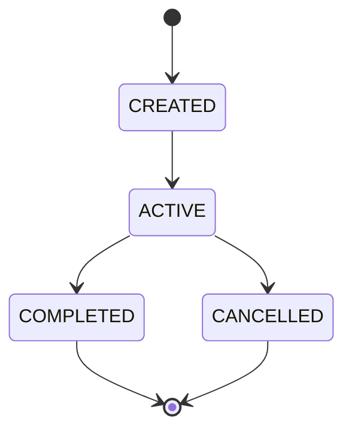

# Event Model

**Reality Engine — Event Model Document**
**Version:** 0.1.0
**Date:** November 1, 2026

This document defines the event model of Reality Engine. It defines all events, their fields, identifiers, constraints, and temporal semantics.

---

## 1. Event Definition

An event is an occurrence in the world. Events are occurrences with a start and end time. They represent things that happen: elections, legislative decisions, natural disasters, economic announcements, scientific discoveries, corporate acquisitions, military developments, infrastructure failures, policy changes, and conflicts.

Events are distinct from claims. A claim is an assertion about the world; an event is an occurrence. Events are stored in the `events` table.

---

## 2. Event Identity

Every event has a stable unique identifier:

```
evt_000001
evt_000002
...
```

The identifier is used as the primary key in the `events` table and as the reference in all queries. The identifier is never reused.

---

## 3. Event Fields

| Field | Type | Required | Description |
|---|---|---|---|
| id | string | Yes | Unique identifier (e.g., `evt_000001`) |
| event_type | string | Yes | Type of event |
| description | string | Yes | Event description |
| location_id | string | No | Foreign key to Entity (location) |
| valid_from | timestamp | Yes | When the event started |
| valid_to | timestamp or null | No | When the event ended |
| recorded_at | timestamp | Yes | When the system recorded it |
| status | string | Yes | Event status |
| created_at | timestamp | Yes | Creation timestamp |
| updated_at | timestamp | No | Update timestamp |

**event_type values:**

| Type | Description |
|---|---|
| ELECTION | Election |
| LEGISLATIVE_DECISION | Legislative decision |
| NATURAL_DISASTER | Natural disaster |
| ECONOMIC_ANNOUNCEMENT | Economic announcement |
| SCIENTIFIC_DISCOVERY | Scientific discovery |
| CORPORATE_ACQUISITION | Corporate acquisition |
| MILITARY_DEVELOPMENT | Military development |
| INFRASTRUCTURE_FAILURE | Infrastructure failure |
| POLICY_CHANGE | Policy change |
| TREATY_SIGNING | Treaty signing |
| CONFLICT | Conflict |
| DEMONSTRATION | Demonstration |
| RESEARCH_PUBLICATION | Research publication |
| PATENT_FILING | Patent filing |
| PRODUCT_RELEASE | Product release |

**event status values:**

| Value | Meaning |
|---|---|
| ACTIVE | The event is currently active |
| COMPLETED | The event is completed |
| CANCELLED | The event was cancelled |
| ANNULLED | The event was annulled |

**Constraints:**

- `location_id` must reference an existing Entity.
- `valid_from` must be less than or equal to `valid_to` (if `valid_to` is set).

---

## 4. Temporal Semantics

Events have temporal validity:

| Field | Meaning |
|---|---|
| valid_from | When the event started in the external world |
| valid_to | When the event ended in the external world |
| recorded_at | When the system recorded the event |

**Example:**

- A government changes a regulation on October 10.
- The change is reported on October 12.
- The system records the report on October 13.
- Later, on October 20, the government publishes a correction establishing that the regulation actually took effect October 11.

**Temporal fields:**

| Field | Value |
|---|---|
| valid_from | 2026-10-11 |
| valid_to | null |
| recorded_at | 2026-10-13 |

A correction is recorded as a new event, not by modifying the original event.

---

## 5. Event Fields in the Ontology

The `events` table includes:

| Column | Type | Purpose |
|---|---|---|
| id | TEXT PRIMARY KEY | Event identifier |
| event_type | TEXT NOT NULL | Type of event |
| description | TEXT NOT NULL | Event description |
| location_id | TEXT | Foreign key to entities |
| valid_from | TEXT NOT NULL | Valid time start |
| valid_to | TEXT | Valid time end |
| recorded_at | TEXT NOT NULL | When the system recorded it |
| status | TEXT NOT NULL | Event status |
| created_at | TEXT NOT NULL | Creation timestamp |
| updated_at | TEXT | Update timestamp |

---

## 6. Event Examples

**Election Event:**

```json
{
  "id": "evt_000001",
  "event_type": "ELECTION",
  "description": "General election held in Country X",
  "location_id": "entity_000001",
  "valid_from": "2026-10-15T08:00:00Z",
  "valid_to": null,
  "recorded_at": "2026-10-15T12:00:00Z",
  "status": "COMPLETED",
  "created_at": "2026-10-15T12:00:00Z"
}
```

**Legislative Decision Event:**

```json
{
  "id": "evt_000002",
  "event_type": "LEGISLATIVE_DECISION",
  "description": "National security law passed by parliament",
  "location_id": "entity_000001",
  "valid_from": "2026-10-14T00:00:00Z",
  "valid_to": "2026-10-14T23:59:59Z",
  "recorded_at": "2026-10-15T08:00:00Z",
  "status": "COMPLETED",
  "created_at": "2026-10-15T08:00:00Z"
}
```

**Natural Disaster Event:**

```json
{
  "id": "evt_000003",
  "event_type": "NATURAL_DISASTER",
  "description": "Major earthquake in Northeast Asia",
  "location_id": "entity_000005",
  "valid_from": "2026-10-01T06:00:00Z",
  "valid_to": "2026-10-01T18:00:00Z",
  "recorded_at": "2026-10-02T09:00:00Z",
  "status": "COMPLETED",
  "created_at": "2026-10-02T09:00:00Z"
}
```

**Policy Change Event:**

```json
{
  "id": "evt_000004",
  "event_type": "POLICY_CHANGE",
  "description": "Government changes energy policy",
  "location_id": "entity_000001",
  "valid_from": "2026-10-10T00:00:00Z",
  "valid_to": null,
  "recorded_at": "2026-10-13T10:00:00Z",
  "status": "ACTIVE",
  "created_at": "2026-10-13T10:00:00Z"
}
```

**Correction Event:**

```json
{
  "id": "evt_000005",
  "event_type": "POLICY_CHANGE",
  "description": "Correction: regulation took effect October 11, not October 10",
  "location_id": "entity_000001",
  "valid_from": "2026-10-11T00:00:00Z",
  "valid_to": null,
  "recorded_at": "2026-10-20T10:00:00Z",
  "status": "ACTIVE",
  "created_at": "2026-10-20T10:00:00Z"
}
```

---

## 7. Event State Machine



| State | Description |
|---|---|
| CREATED | The event has been created |
| ACTIVE | The event is currently active |
| COMPLETED | The event is completed |
| CANCELLED | The event was cancelled |

---

## 8. Relationship with Other Objects

Events are connected to other objects:

| Relationship | Direction | Meaning |
|---|---|---|
| Entity `PARTICIPATES_IN` Event | Entity → Event | An entity participates in the event |
| Location → Event | Entity → Event | The location of the event |
| Claim `CONTAINS` Event | Claim → Event | A claim describes an event |
| Observation `RECORDS` Event | Observation → Event | An observation records an event |
| Event `PRECEDES` Event | Event → Event | One event precedes another |

---

## 9. References

- ONTOLOGY.md — common ontology definitions
- TEMPORAL_MODEL.md — bitemporal semantics
- ENTITY_MODEL.md — entity definitions
- BELIEF_REVISION.md — how events affect beliefs
- REVISION_STATE_MACHINE.md — how revisions interact with events
