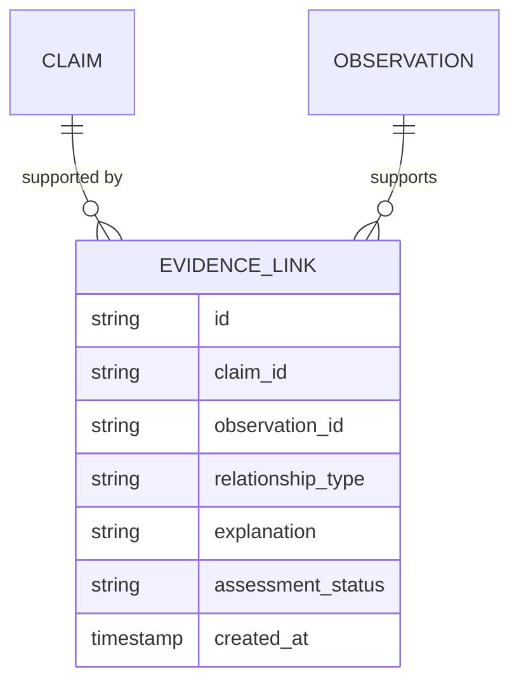

# Evidence Model

**Reality Engine — Evidence Model Document**
**Version:** 0.1.0
**Date:** November 1, 2026

This document defines the evidence model of Reality Engine. It defines evidence relationships, evidence quality, and source independence.

---

## 1. Evidence Definition

Evidence is information supporting or challenging a claim. Evidence is distinct from the claim itself. Evidence must be preserved immutably and traceable to its source.

**Example:**

- Government data supporting "Inflation is increasing" (SUPPORTS).
- A contradictory report (CONTRADICTS).
- A qualification to a claim (QUALIFIES).

Evidence is represented through evidence links. The evidence link is the relationship between a claim and an observation, with provenance and an explanation.

---

## 2. Evidence Relationship Model

Evidence links connect claims to observations:



**Evidence relationship types:**

| Type | Meaning |
|---|---|
| SUPPORTS | Evidence supports the claim |
| CONTRADICTS | Evidence contradicts the claim |
| QUALIFIES | Evidence qualifies the claim |
| DERIVED_FROM | Evidence is derived from the claim |
| REPEATS | Evidence repeats the claim |
| ATTRIBUTED_TO | Evidence is attributed to the claim |
| SUPERSEDES | Evidence supersedes the claim |
| CORROBORATES | Evidence corroborates the claim |

---

## 3. Evidence Link Fields

| Field | Type | Required | Description |
|---|---|---|---|
| id | string | Yes | Evidence link identifier |
| claim_id | string | Yes | Foreign key to Claim |
| observation_id | string | No | Foreign key to Observation |
| relationship_type | string | Yes | Relationship type |
| explanation | string | No | Explanation of the inference |
| assessment_status | string | Yes | Assessment status |
| created_at | timestamp | Yes | Creation timestamp |

**relationship_type values:**

| Type | Description |
|---|---|
| SUPPORTS | Evidence supports the claim |
| CONTRADICTS | Evidence contradicts the claim |
| QUALIFIES | Evidence qualifies the claim |
| DERIVED_FROM | Evidence is derived from the claim |
| REPEATS | Evidence repeats the claim |
| ATTRIBUTED_TO | Evidence is attributed to the claim |
| SUPERSEDES | Evidence supersedes the claim |
| CORROBORATES | Evidence corroborates the claim |

**assessment_status values:**

| Value | Meaning |
|---|---|
| SUPPORTED | Evidence supports the claim |
| CONTRADICTED | Evidence contradicts the claim |
| PARTIALLY_SUPPORTED | Some evidence supports, some challenges |
| CONTESTED | Competing evidence exists |
| UNRESOLVED | Insufficient evidence |

---

## 4. Evidence Quality

Evidence quality is multidimensional. Do not collapse evidence quality into one universal reliability score.

### 4.1 Quality Dimensions

| Dimension | Question |
|---|---|
| Source authenticity | Is the source authentic? |
| Source expertise | Is the source expert in the subject? |
| Directness | Is the evidence direct or secondhand? |
| Measurement quality | How reliable is the underlying measurement? |

**Constraint:** Domain-specific scoring may be introduced later, with explicit methodology.

---

## 5. Source Independence

Source independence is the assessment of whether information from different sources is genuinely independent or derived from a common origin.

### 5.1 Source Independence Classifications

| Classification | Meaning |
|---|---|
| INDEPENDENT | Genuinely separate observations |
| SHARED_ORIGIN | Common source or dataset |
| PARTIALLY_DEPENDENT | Partially shared origin |
| UNKNOWN | Dependence cannot be determined |
| NOT_APPLICABLE | No relationship exists |

**Constraint:** An unknown relationship must not be interpreted as independence.

### 5.2 Source Lineage Examples

**Example 1 — Five independent observations:**

```text
SOURCE A → CLAIM X
SOURCE B → CLAIM X
SOURCE C → CLAIM X
SOURCE D → CLAIM X
SOURCE E → CLAIM X
```

All five sources are independent. They each provide independent confirmation.

**Example 2 — One press release, five news articles:**

```text
ORIGINAL STATEMENT → NEWS SOURCE A
ORIGINAL STATEMENT → NEWS SOURCE B
ORIGINAL STATEMENT → NEWS SOURCE C
ORIGINAL STATEMENT → NEWS SOURCE D
ORIGINAL STATEMENT → NEWS SOURCE E
```

The five media reports do not represent five independent observations. They share a common origin.

---

## 6. Evidence Provenance

Every claim must be traceable to one or more source documents. Provenance fields:

| Field | Description |
|---|---|
| Source ID | The source that published the claim |
| Document ID | The document containing the claim |
| Original URL | The original URL |
| Relevant passage | The passage that supports the claim |
| Page or paragraph location | The location within the document |
| Extraction timestamp | When the claim was extracted |
| Extraction model | The model used for extraction |
| Model version | The model version |
| Extraction prompt version | The prompt version |
| Validation status | Whether the claim passed validation |

---

## 7. Evidence Constraints

1. **Immutability:** Evidence is never silently destroyed.
2. **Provenance:** Every claim must be traceable to a source.
3. **Non-independence:** Unknown relationships must not be treated as independent.
4. **Duplication:** Syndicated reporting must be distinguished from independent confirmation.
5. **Evaluation:** Evidence quality is multidimensional.

---

## 8. JSON Schema Example

**Evidence Link:**

```json
{
  "id": "evlink_000001",
  "claim_id": "claim_000001",
  "observation_id": "obs_000001",
  "relationship_type": "SUPPORTS",
  "explanation": "Government data directly supports the claim",
  "assessment_status": "SUPPORTED",
  "created_at": "2026-10-16T10:00:00Z"
}
```

---

## 9. References

- ONTOLOGY.md — common ontology definitions
- OBSERVATION_MODEL.md — observation definitions
- CLAIM_MODEL.md — claim definitions
- SOURCE_LINEAGE.md — source lineage definitions
- SOURCE_INDEPENDENCE.md — source independence definitions
- EVIDENCE_ASSESSMENT.md — evidence assessment
- REVISION_STATE_MACHINE.md — how evidence is used in revisions
