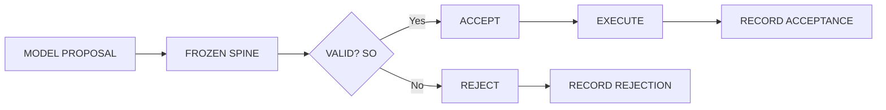

# Frozen Spine Integration

**Reality Engine — Frozen Spine Integration Document**
**Version:** 0.1.0
**Date:** November 1, 2026

This document defines the Frozen Spine integration of Reality Engine. It covers the authorization and execution boundary.

---

## 1. Frozen Spine Integration Overview

Frozen Spine provides the authorization and execution boundary. The model proposes an operation. The deterministic control plane validates the operation.

---

## 2. Frozen Spine Flow

---

## 3. Frozen Spine Responsibilities

Frozen Spine validates:

| Field | Description |
|---|---|
| Actor | The actor performing the operation |
| Requested operation | The operation requested |
| Resource | The resource of the operation |
| Permission | The permission granted |

---

## 4. Frozen Spine Decision

The Frozen Spine decides:

| Decision | Description |
|---|---|
| ACCEPT | The operation is accepted |
| REJECT | The operation is rejected |

The resulting decision is recorded.

---

## 5. Constraints

1. **Frozen Spine should provide the authorization and execution boundary.**
2. **The model proposes an operation.**
3. **The deterministic control plane validates the operation.**
