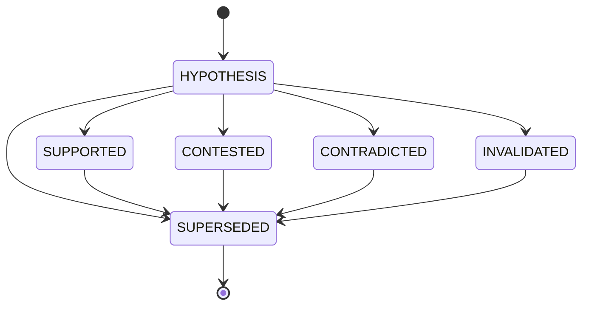
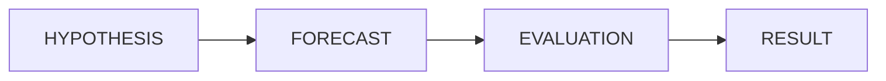

# Hypothesis Model

**Reality Engine — Hypothesis Model Document**
**Version:** 0.1.0
**Date:** November 1, 2026

This document defines the hypothesis model of Reality Engine. It defines all hypotheses, their fields, constraints, and evaluation.

---

## 1. Hypothesis Definition

A hypothesis is an explanatory model for observed events. Hypotheses propose explanations for correlations, temporal sequences, and other patterns. They are distinct from claims because they are explicitly speculative.

**Example:**

- "Energy prices will increase because energy supply is declining."
- "Inflation will remain elevated because energy prices rose."
- "Inflation is increasing because the central bank expanded the money supply."

---

## 2. Hypothesis Fields

| Field | Type | Required | Description |
|---|---|---|---|
| id | string | Yes | Hypothesis identifier |
| statement | string | Yes | The hypothesis statement |
| domain_id | string | Yes | Foreign key to Domain |
| status | string | Yes | Hypothesis status |
| prior_assumptions | string | Yes | Prior assumptions |
| methodology | string | Yes | Methodology |
| created_at | timestamp | Yes | Creation timestamp |
| revised_at | timestamp or null | No | Last revision timestamp |

**status values:**

| Value | Meaning |
|---|---|
| HYPOTHESIS | Proposed hypothesis |
| SUPPORTED | Supported by evidence |
| CONTESTED | Contested by evidence |
| CONTRADICTED | Contradicted by evidence |
| INVALIDATED | Invalidated by evidence |
| SUPERSEDED | Replaced by a newer hypothesis |

**Constraints:**

- `domain_id` must reference an existing Domain.

---

## 3. Hypothesis Structure

A hypothesis is structured as:

- **Statement:** The hypothesis statement.
- **Domain:** The domain it belongs to.
- **Status:** The current evidence status.
- **Prior assumptions:** The assumptions made.
- **Methodology:** The methodology used.
- **Creation timestamp:** When it was created.
- **Revision timestamp:** When it was revised.

---

## 4. Hypothesis Examples

**Energy Hypothesis:**

```json
{
  "id": "hypothesis_000001",
  "statement": "Energy supply is declining, which will increase energy prices and inflationary pressure.",
  "domain_id": "economic",
  "status": "CONTESTED",
  "prior_assumptions": "Supply follows demand; energy prices track supply",
  "methodology": "Systematic review of energy market data",
  "created_at": "2026-10-15T00:00:00Z",
  "revised_at": null
}
```

**Inflation Hypothesis:**

```json
{
  "id": "hypothesis_000002",
  "statement": "Inflation will remain elevated in the next quarter because energy prices have risen.",
  "domain_id": "economic",
  "status": "UNRESOLVED",
  "prior_assumptions": "Energy prices are passed through to consumer prices",
  "methodology": "Econometric model with energy price adjustment",
  "created_at": "2026-10-15T00:00:00Z",
  "revised_at": null
}
```

---

## 5. Hypothesis Lifecycle



| State | Description |
|---|---|
| HYPOTHESIS | Proposed hypothesis |
| SUPPORTED | Supported by evidence |
| CONTESTED | Contested by evidence |
| CONTRADICTED | Contradicted by evidence |
| INVALIDATED | Invalidated by evidence |
| SUPERSEDED | Replaced by a newer hypothesis |

---

## 6. Relationship with Other Objects

| Relationship | Direction | Meaning |
|---|---|---|
| Hypothesis `PREDICTS` Forecast | Hypothesis → Forecast | The hypothesis predicts an outcome |
| Hypothesis `SUPPORTS` Claim | Hypothesis → Claim | The hypothesis supports the claim |
| Hypothesis `CONTRADICTS` Claim | Hypothesis → Claim | The hypothesis contradicts the claim |
| Hypothesis `INVALIDATED_BY` Observation | Observation → Hypothesis | The observation invalidates the hypothesis |

---

## 7. Forecaster Interaction

The Forecaster agent generates forecasts based on hypotheses:



1. The Forecaster selects a hypothesis.
2. The Forecaster generates a testable prediction.
3. The Forecaster records the probability and time horizon.
4. The forecast is evaluated against actual outcomes.
5. The result is recorded.

---

## 6. Constraints

1. **Identity:** Each hypothesis must have a stable unique identifier.
2. **Temporal:** `valid_from` must be less than or equal to `valid_to` (if `valid_to` is set). All timestamps are in UTC.
3. **Domain:** A hypothesis belongs to a domain.
4. **Status:** Hypothesis status is explicitly stored.
5. **Revision:** Hypotheses can be revised. Earlier versions are preserved.

---

## 7. References

- ONTOLOGY.md — common ontology definitions
- CLAIM_MODEL.md — claim definitions
- FORECAST_MODEL.md — forecast definitions
- REVISION_MODEL.md — revision definitions
- REVISION_STATE_MACHINE.md — how hypotheses are revised
