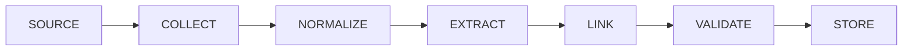

# Ingestion Pipeline

**Reality Engine — Ingestion Pipeline Document**
**Version:** 0.1.0
**Date:** November 1, 2026

This document defines the ingestion pipeline of Reality Engine. It covers the pipeline stages, idempotency, and failure handling.

---

## 1. Pipeline Overview

The ingestion pipeline transforms external documents into internal data:

---

## 2. Pipeline Stages

| Stage | Responsibility |
|---|---|
| Collection | The Observation Engine gathers items from sources |
| Normalization | The normalization component converts source-specific formats into normalized documents |
| Extraction | The Evidence Engine extracts observations and claims from documents |
| Linking | The evidence engine links claims to evidence and source passages |
| Validation | The Evidence Engine validates schema, provenance, and temporal consistency |
| Storage | The World Model stores the verified information |

---

## 3. Idempotency

The pipeline must be idempotent. Processing the same document twice should not create duplicate observations or artificially increase confidence.

**Constraint:** Each stage must have explicit input/output contracts, allowing failed stages to be retried without repeating successful work.

---

## 4. Failure Handling

| Failure | Handling |
|---|---|
| Source adapter failure | Report health, retry |
| Extraction failure | Log, preserve original, do not fabricate |
| Validation failure | Log, mark document for review |
| Storage failure | Fail closed, prevent data loss |

---

## 5. Constraints

1. **The pipeline must be idempotent.**
2. **Each stage must have explicit input/output contracts.**
3. **Failed stages must be retryable.**
