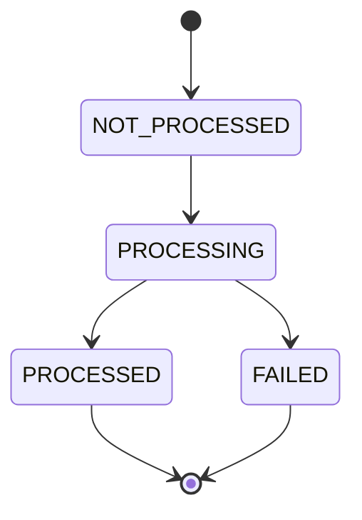

# Observation Model

**Reality Engine — Observation Model Document**
**Version:** 0.1.0
**Date:** November 1, 2026

This document defines the observation model of Reality Engine. It defines all observations, their fields, constraints, and temporal semantics.

---

## 1. Observation Definition

An observation is a directly measured or recorded observation. Observations are the raw material of the system's understanding. They are the record of something that was measured, witnessed, or documented.

Observations are stored in the `observations` table.

**Example:**

- A CPI reading of 3.2% released this week.
- A report that a shipment was delayed.
- A government announcement that a new policy is in effect.
- A scientific measurement of temperature at a specific location.

---

## 2. Observation Fields

| Field | Type | Required | Description |
|---|---|---|---|
| id | string | Yes | Unique identifier (e.g., `obs_000018`) |
| observation_type | string | Yes | Type of observation |
| subject_id | string | Yes | Foreign key to Entity |
| observed_value | string | Yes | The observed value |
| unit | string | No | Measurement unit |
| valid_from | timestamp | Yes | When the observation applies |
| valid_to | timestamp or null | No | When the observation ceased to apply |
| recorded_at | timestamp | Yes | When the system recorded it |
| source_id | string | Yes | Foreign key to Source |
| document_id | string | Yes | Foreign key to Document |
| provenance_reference | string | No | Reference to the provenance record |
| extraction_version | string | No | Extraction version |
| created_at | timestamp | Yes | Creation timestamp |

**observation_type values:**

| Type | Description |
|---|---|
| MEASUREMENT | A measured value |
| REPORT | A reported observation |
| MANIFESTATION | An occurrence |
| EVENT | An event occurrence |
| STATEMENT | A statement |

**Constraints:**

- `source_id` must reference an existing Source.
- `document_id` must reference an existing Document.
- `subject_id` must reference an existing Entity.
- `valid_from` must be less than or equal to `valid_to` (if `valid_to` is set).
- `recorded_at` must be greater than or equal to `valid_from`.
- `observed_value` is stored as text to preserve arbitrary values.

---

## 3. Temporal Semantics

Observations have temporal validity:

| Field | Meaning |
|---|---|
| valid_from | When the observation applies to the external world |
| valid_to | When the observation ceased to apply |
| recorded_at | When the system recorded the observation |

**Example — CPI reading:**

| Field | Value |
|---|---|
| valid_from | 2026-10-15 |
| valid_to | null |
| recorded_at | 2026-10-16 |

**Example — Delayed report:**

| Field | Value |
|---|---|
| valid_from | 2026-10-01 |
| valid_to | null |
| recorded_at | 2026-10-15 |

**Example — Correction:**

A corrected value has a new observation with the corrected valid time.

**Example — Correction of a reported event:**

| Original | Corrected |
|---|---|
| valid_from | 2026-10-10 |
| valid_to | null |
| recorded_at | 2026-10-13 |

| Corrected | Corrected |
|---|---|
| valid_from | 2026-10-11 |
| valid_to | null |
| recorded_at | 2026-10-20 |

---

## 4. Observation Types

| Type | Description | Example |
|---|---|---|
| MEASUREMENT | A measured value | CPI = 3.2% |
| REPORT | A reported observation | "The shipment was delayed" |
| MANIFESTATION | An occurrence | A protest occurred in City X |
| EVENT | An event occurrence | The election took place |
| STATEMENT | A statement | "Inflation is increasing" |

**Constraints:**

- A measurement is directly measured.
- A report is reported by a source.
- A manifestation is an occurrence.
- An event is an event occurrence.
- A statement is a statement.

---

## 5. Observation Lifecycle



| State | Description |
|---|---|
| NOT_PROCESSED | The observation has not been processed |
| PROCESSING | The observation is being processed |
| PROCESSED | The observation has been processed |
| FAILED | The observation failed to process |

---

## 6. JSON Schema Example

**Observation:**

```json
{
  "id": "obs_000018",
  "observation_type": "MEASUREMENT",
  "subject_id": "entity_001",
  "observed_value": "3.2",
  "unit": "percent",
  "valid_from": "2026-10-15T00:00:00Z",
  "valid_to": null,
  "recorded_at": "2026-10-16T10:00:00Z",
  "source_id": "src_000001",
  "document_id": "doc_000001",
  "provenance_reference": "prov_000001",
  "extraction_version": "v1.0.0",
  "created_at": "2026-10-16T10:00:00Z"
}
```

---

## 7. Observation Examples

**CPI Reading:**

```json
{
  "id": "obs_000001",
  "observation_type": "MEASUREMENT",
  "subject_id": "entity_000001",
  "observed_value": "3.2",
  "unit": "percent",
  "valid_from": "2026-10-15T00:00:00Z",
  "valid_to": null,
  "recorded_at": "2026-10-16T10:00:00Z",
  "source_id": "src_000001",
  "document_id": "doc_000001",
  "provenance_reference": "prov_000001",
  "extraction_version": "v1.0.0",
  "created_at": "2026-10-16T10:00:00Z"
}
```

**Delayed Report:**

```json
{
  "id": "obs_000002",
  "observation_type": "REPORT",
  "subject_id": "entity_000002",
  "observed_value": "Shipment delayed",
  "valid_from": "2026-10-01T00:00:00Z",
  "valid_to": null,
  "recorded_at": "2026-10-15T10:00:00Z",
  "source_id": "src_000002",
  "document_id": "doc_000002",
  "provenance_reference": "prov_000002",
  "extraction_version": "v1.0.0",
  "created_at": "2026-10-15T10:00:00Z"
}
```

**Statement:**

```json
{
  "id": "obs_000003",
  "observation_type": "STATEMENT",
  "subject_id": "entity_000001",
  "observed_value": "Inflation is increasing",
  "valid_from": "2026-10-14T00:00:00Z",
  "valid_to": null,
  "recorded_at": "2026-10-15T10:00:00Z",
  "source_id": "src_000001",
  "document_id": "doc_000001",
  "provenance_reference": "prov_000003",
  "extraction_version": "v1.0.0",
  "created_at": "2026-10-15T10:00:00Z"
}
```

---

## 8. References

- ONTOLOGY.md — common ontology definitions
- TEMPORAL_MODEL.md — bitemporal semantics
- ENTITY_MODEL.md — entity definitions
- CLAIM_MODEL.md — claim definitions
- BELIEF_REVISION.md — how observations affect beliefs
- REVISION_STATE_MACHINE.md — how revisions interact with observations
