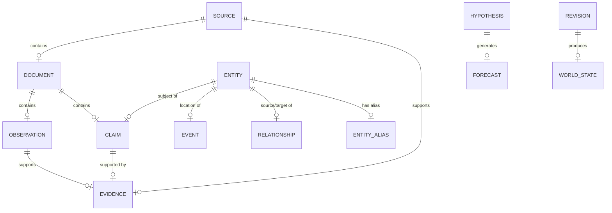

# Ontology

**Reality Engine — Ontology Document**
**Version:** 0.1.0
**Date:** November 1, 2026

This document defines the complete ontology of Reality Engine. It defines all important objects, fields, relationships, identifiers, and constraints. Every JSON schema in the `schemas/` directory conforms to this ontology.

---

## 1. Ontological Foundation

The ontology is built on the premise that the system models observations and interpretations of external reality. It does not claim direct access to reality itself.

### 1.1 The Three Representations

Reality Engine maintains three independent but connected representations:

| Representation | Meaning |
|---|---|
| **External reality** | The actual world: physical events, human activity, institutions, processes |
| **Observation** | The incomplete information available about that world |
| **Understanding** | The computational model constructed from those observations |

This distinction is fundamental. The system must never confuse external reality with its internal representation.

### 1.2 The Five Core Objects

| Object | Meaning | Example |
|---|---|---|
| **Observation** | Something directly measured or recorded | A CPI reading of 3.2% released this week |
| **Claim** | An assertion about the world | "Inflation is increasing" |
| **Evidence** | Information supporting or challenging a claim | Government data, a research paper, a contradictory report |
| **Hypothesis** | An explanation for observed events | "Inflation will remain elevated because energy prices rose" |
| **Conclusion** | An assessment derived from available evidence | "The policy is not yet supported as effective" |

These objects must never be interchangeable.

---

## 2. Object Types

The following object types are defined in the ontology:

| Type | Description |
|---|---|
| Source | The origin of information |
| Document | The collected material from a source |
| Observation | A directly measured or recorded observation |
| Claim | An assertion about the world |
| Evidence | Information supporting or challenging a claim |
| Relationship | A connection between entities, events, claims, or hypotheses |
| Entity | An identifiable object in the world |
| Event | An occurrence with a start and end time |
| Condition | A state or observable condition |
| Hypothesis | An explanatory model |
| Forecast | A formal prediction |
| Conclusion | An assessment derived from evidence |
| Domain | A logical division of the world model |
| Revision | A controlled change to the world model |
| Audit event | A record of a significant operation |
| World-state snapshot | A versioned snapshot of the world state |
| Agent task | A structured input to an agent |
| Agent response | A structured output from an agent |

---

## 3. Common Object Structure

All objects share a common structure. The fields below apply to most objects:

| Field | Type | Meaning |
|---|---|---|
| id | string | Stable unique identifier |
| status | enum | Current status of the object |
| created_at | timestamp (UTC) | When the object was created |
| updated_at | timestamp (UTC) | When the object was last updated |
| metadata | object | Free-form metadata |

Objects with temporal validity also have:

| Field | Type | Meaning |
|---|---|---|
| valid_from | timestamp (UTC) | When the object applies to the external world |
| valid_to | timestamp (UTC) or null | When the object ceased to apply |
| recorded_at | timestamp (UTC) | When the system recorded it |
| superseded_at | timestamp (UTC) or null | When the object was replaced |

---

## 4. Object Definitions

### 4.1 Source

A source is the origin of information. It is the first object in the provenance chain.

**Required fields:**

| Field | Type | Description |
|---|---|---|
| id | string | Stable unique identifier (e.g., `src_000001`) |
| name | string | Source name (e.g., "Reuters") |
| source_type | enum | Type of source (news, economic, scientific, government, etc.) |
| canonical_domain | string | Canonical domain classification |
| authority_metadata | object | Authority metadata (see below) |
| collection_policy | object | Collection policy rules |
| created_at | timestamp (UTC) | When the source was registered |

**authority_metadata fields:**

| Field | Type | Description |
|---|---|---|
| reliability_score | float | Reliability score (domain-specific) |
| expertise | array of string | Areas of expertise |
| known_limits | array of string | Known limitations |
| access_restrictions | array of string | Access restrictions |

**collection_policy fields:**

| Field | Type | Description |
|---|---|---|
| collection_interval | string | How often to collect |
| deduplication_enabled | boolean | Whether deduplication is enabled |
| rate_limit | integer | Rate limit |
| retry_policy | string | Retry policy |

**Constraints:**

- `name` must be unique.
- `source_type` must be one of: NEWS, ECONOMIC, SCIENTIFIC, GOVERNMENT, INSTITUTIONAL, OTHER.

---

### 4.2 Document

A document is the collected material from a source.

**Required fields:**

| Field | Type | Description |
|---|---|---|
| id | string | Document identifier |
| source_id | string | Foreign key to Source |
| source_native_id | string | Source-native identifier |
| canonical_url | string | Canonical URL |
| content_hash | string | Cryptographic hash of the content |
| content_type | string | Document type (article, report, dataset, etc.) |
| language | string | Original language (ISO 639-1 code) |
| published_at | timestamp (UTC) | Publication timestamp |
| collected_at | timestamp (UTC) | Collection timestamp |
| content_reference | string | Reference to the original content |
| processing_status | enum | Processing state (NOT_PROCESSED, PROCESSING, PROCESSED, FAILED) |
| updated_at | timestamp (UTC) | Last update timestamp |

**Constraints:**

- `source_id` must reference an existing Source.
- `content_hash` must be unique across all documents.
- `canonical_url` must be unique per source.

---

### 4.3 Observation

An observation is a directly measured or recorded observation.

**Required fields:**

| Field | Type | Description |
|---|---|---|
| id | string | Observation identifier |
| observation_type | enum | Type of observation |
| subject_id | string | Foreign key to Entity |
| observed_value | string | The observed value |
| unit | string | Measurement unit |
| valid_from | timestamp (UTC) | When the observation applies |
| valid_to | timestamp (UTC) or null | When the observation ceased to apply |
| recorded_at | timestamp (UTC) | When the system recorded it |
| source_id | string | Foreign key to Source |
| document_id | string | Foreign key to Document |
| provenance_reference | string | Reference to the provenance record |
| extraction_version | string | Extraction version |
| created_at | timestamp (UTC) | Creation timestamp |

**observation_type values:**

| Value | Description |
|---|---|
| MEASUREMENT | A measured value |
| REPORT | A reported observation |
| MANIFESTATION | An occurrence |
| EVENT | An event occurrence |
| STATEMENT | A statement |

**Constraints:**

- `source_id` must reference an existing Source.
- `document_id` must reference an existing Document.
- `subject_id` must reference an existing Entity.
- `valid_from` must be less than or equal to `valid_to` (if `valid_to` is set).
- `recorded_at` must be greater than or equal to `valid_from`.

---

### 4.4 Claim

A claim is an assertion about the world.

**Required fields:**

| Field | Type | Description |
|---|---|---|
| id | string | Claim identifier |
| subject_id | string | Foreign key to Entity |
| predicate | string | Predicate (relationship type) |
| object_value | string | The claim's object |
| claim_type | enum | Claim type |
| domain_id | string | Foreign key to Domain |
| valid_from | timestamp (UTC) | When the claim applies |
| valid_to | timestamp (UTC) or null | When the claim ceased to apply |
| recorded_at | timestamp (UTC) | When the system recorded it |
| status | enum | Evidence status |
| revision_number | integer | Revision counter |
| created_at | timestamp (UTC) | Creation timestamp |

**claim_type values:**

| Value | Description |
|---|---|
| FACTUAL | Assertion about an event or condition |
| REPORTED | Assertion attributed to another source |
| INTERPRETIVE | Explanation or interpretation |
| PREDICTIVE | Assertion about a future outcome |
| NORMATIVE | Value judgment or recommendation |
| HYPOTHETICAL | Conditional proposition |
| QUANTITATIVE | Assertion involving measurable values |

**status values:**

| Value | Description |
|---|---|
| UNASSESSED | Not yet evaluated |
| SUPPORTED | Evidence supports the claim |
| PARTIALLY_SUPPORTED | Some evidence supports, some challenges |
| CONTESTED | Competing claims exist |
| CONTRADICTED | Evidence directly challenges the claim |
| UNRESOLVED | Insufficient evidence to decide |
| SUPERSEDED | Replaced by a newer version |
| WITHDRAWN | Explicitly withdrawn |

**Constraints:**

- `subject_id` must reference an existing Entity.
- `domain_id` must reference an existing Domain.
- `valid_from` must be less than or equal to `valid_to` (if `valid_to` is set).
- `recorded_at` must be greater than or equal to `valid_from`.
- `status` must be one of the values listed above.

---

### 4.5 Evidence

Evidence is information supporting or challenging a claim.

**Object definition:**

Evidence is represented by evidence links (see EVIDENCE_LINK in the schemas). It is not a separate stored object but a relationship with provenance.

**Supported relationship types:**

| Type | Meaning |
|---|---|
| SUPPORTS | Evidence supports the claim |
| CONTRADICTS | Evidence contradicts the claim |
| QUALIFIES | Evidence qualifies the claim |
| DERIVED_FROM | Evidence is derived from the claim |
| REPEATS | Evidence repeats the claim |
| ATTRIBUTED_TO | Evidence is attributed to the claim |
| SUPERSEDES | Evidence supersedes the claim |
| CORROBORATES | Evidence corroborates the claim |

**Constraints:**

- Every evidence relationship must contain its own provenance.
- Where applicable, an explanation of the inference must be included.

---

### 4.6 Relationship

A relationship connects entities, events, claims, or hypotheses.

**Required fields:**

| Field | Type | Description |
|---|---|---|
| id | string | Relationship identifier |
| source_entity_id | string | Foreign key to source entity |
| target_entity_id | string | Foreign key to target entity |
| relationship_type | string | Type of relationship |
| valid_from | timestamp (UTC) | When the relationship applies |
| valid_to | timestamp (UTC) or null | When the relationship ceased to apply |
| recorded_at | timestamp (UTC) | When the system recorded it |
| evidence_status | string | Evidence status |
| created_at | timestamp (UTC) | Creation timestamp |

**relationship_type values:**

| Type | Meaning |
|---|---|
| LOCATED_IN | Entity is located in a place |
| MEMBER_OF | Entity is a member of a group |
| OWNS | Entity owns something |
| CONTROLS | Entity controls something |
| PARTICIPATES_IN | Entity participates in an event |
| ANNOUNCED | Entity announced something |
| AFFECTS | Entity affects something |
| SUPPORTS | Entity supports something |
| CONTRADICTS | Entity contradicts something |
| PRECEDES | Entity precedes something |
| FOLLOWS | Entity follows something |
| DEPENDS_ON | Entity depends on something |
| CORRELATES_WITH | Entity correlates with something |
| CAUSES | Entity causes something |
| CAUSED_BY_HYPOTHESIS | Entity is caused by a hypothesis |
| PREDICTS | Entity predicts something |
| DERIVED_FROM | Entity is derived from something |

**Constraints:**

- Causal relationships require stronger evidence and explicit methodological justification than ordinary associations.
- The same relationship type must not be created with different meanings.
- `valid_from` must be less than or equal to `valid_to` (if `valid_to` is set).

---

### 4.7 Entity

An entity represents an identifiable object in the world.

**Required fields:**

| Field | Type | Description |
|---|---|---|
| id | string | Entity identifier |
| canonical_name | string | Canonical name |
| entity_type | enum | Type of entity |
| domain_id | string | Foreign key to Domain |
| created_at | timestamp (UTC) | Creation timestamp |
| updated_at | timestamp (UTC) | Update timestamp |
| status | string | Entity status |

**entity_type values:**

| Type | Description |
|---|---|
| COUNTRY | Country |
| GOVERNMENT | Government |
| ORGANIZATION | Organization |
| PERSON | Person |
| REGION | Geographic region |
| INSTITUTION | Institution |
| SCIENTIFIC_ORGANIZATION | Scientific organization |
| INFRASTRUCTURE_SYSTEM | Infrastructure system |
| TECHNOLOGY | Technology |

**Constraints:**

- `canonical_name` must be unique per domain.
- `entity_type` must be one of the values listed above.

---

### 4.8 Entity Alias

An entity alias is an alternate name for an entity.

**Required fields:**

| Field | Type | Description |
|---|---|---|
| id | string | Alias identifier |
| entity_id | string | Foreign key to Entity |
| alias | string | The alias |
| language | string | Language (ISO 639-1 code) |
| source_id | string | Foreign key to Source |
| valid_from | timestamp (UTC) | When the alias applies |
| valid_to | timestamp (UTC) or null | When the alias ceased to apply |
| created_at | timestamp (UTC) | Creation timestamp |

**Constraints:**

- `entity_id` must reference an existing Entity.
- `source_id` must reference an existing Source.
- `valid_from` must be less than or equal to `valid_to` (if `valid_to` is set).

---

### 4.9 Event

An event represents an occurrence.

**Required fields:**

| Field | Type | Description |
|---|---|---|
| id | string | Event identifier |
| event_type | string | Type of event |
| description | string | Event description |
| location_id | string | Foreign key to Entity |
| valid_from | timestamp (UTC) | When the event started |
| valid_to | timestamp (UTC) or null | When the event ended |
| recorded_at | timestamp (UTC) | When the system recorded it |
| status | string | Event status |
| created_at | timestamp (UTC) | Creation timestamp |

**event_type values:**

| Type | Description |
|---|---|
| ELECTION | Election |
| LEGISLATIVE_DECISION | Legislative decision |
| NATURAL_DISASTER | Natural disaster |
| ECONOMIC_ANNOUNCEMENT | Economic announcement |
| SCIENTIFIC_DISCOVERY | Scientific discovery |
| CORPORATE_ACQUISITION | Corporate acquisition |
| MILITARY_DEVELOPMENT | Military development |
| INFRASTRUCTURE_FAILURE | Infrastructure failure |
| POLICY_CHANGE | Policy change |
| TREATY_SIGNING | Treaty signing |
| CONFLICT | Conflict |
| DEMONSTRATION | Demonstration |

**Constraints:**

- `location_id` must reference an existing Entity.
- `valid_from` must be less than or equal to `valid_to` (if `valid_to` is set).

---

### 4.10 Condition

A condition is a state or observable condition.

**Object definition:**

Conditions are specialized entities that represent states. They are stored in the `entities` table with `entity_type` = "CONDITION".

**Key fields:**

| Field | Type | Description |
|---|---|---|
| id | string | Condition identifier |
| canonical_name | string | Canonical name (e.g., "Inflation rate") |
| entity_type | string | Must be "CONDITION" |
| valid_from | timestamp (UTC) | When the condition applies |
| valid_to | timestamp (UTC) or null | When the condition ceased to apply |
| observed_value | string | The observed value |
| unit | string | Measurement unit |

---

### 4.11 Hypothesis

A hypothesis is an explanatory model.

**Required fields:**

| Field | Type | Description |
|---|---|---|
| id | string | Hypothesis identifier |
| statement | string | The hypothesis statement |
| domain_id | string | Foreign key to Domain |
| status | string | Hypothesis status |
| prior_assumptions | string | Prior assumptions |
| methodology | string | Methodology |
| created_at | timestamp (UTC) | Creation timestamp |
| revised_at | timestamp (UTC) or null | Last revision timestamp |

**status values:**

| Value | Description |
|---|---|
| HYPOTHESIS | Proposed hypothesis |
| SUPPORTED | Supported by evidence |
| CONTESTED | Contested by evidence |
| CONTRADICTED | Contradicted by evidence |
| INVALIDATED | Invalidated by evidence |
| SUPERSEDED | Replaced by a newer hypothesis |

**Constraints:**

- `domain_id` must reference an existing Domain.

---

### 4.12 Forecast

A forecast is a formal prediction.

**Required fields:**

| Field | Type | Description |
|---|---|---|
| id | string | Forecast identifier |
| hypothesis_id | string | Foreign key to Hypothesis |
| predicted_outcome | string | Predicted outcome |
| probability | float | Predicted probability (0.0 to 1.0) |
| evaluation_horizon | string | Evaluation horizon |
| resolution_criteria | string | Resolution criteria |
| created_at | timestamp (UTC) | Creation timestamp |
| evaluated_at | timestamp (UTC) or null | When evaluated |
| observed_outcome | string | Actual outcome |
| score | float | Scoring result |
| status | string | Forecast status |

**Constraints:**

- `probability` must be between 0.0 and 1.0.
- `hypothesis_id` must reference an existing Hypothesis.

---

### 4.13 Conclusion

A conclusion is an assessment derived from available evidence.

**Object definition:**

Conclusions are derived from claims and evidence. They are not stored as separate objects but are represented as assessment results in the revision engine.

---

### 4.14 Domain

A domain is a logical division of the world model.

**Required fields:**

| Field | Type | Description |
|---|---|---|
| id | string | Domain identifier |
| name | string | Domain name |
| description | string | Domain description |
| created_at | timestamp (UTC) | Creation timestamp |

**domain values:**

| Value | Description |
|---|---|
| GEOPOLITICAL | Geopolitical systems |
| ECONOMIC | Economic systems |
| FINANCIAL | Financial systems |
| SCIENTIFIC | Scientific systems |
| TECHNOLOGICAL | Technological systems |
| ENVIRONMENTAL | Environmental systems |
| SOCIAL | Social and demographic systems |
| SECURITY | Military and security systems |
| LEGAL | Legal and institutional systems |
| INFRASTRUCTURE | Infrastructure and energy systems |

**Constraints:**

- `name` must be unique.

---

### 4.15 Revision

A revision is a controlled change to the world model.

**Revision state machine:**

| State | Description |
|---|---|
| PROPOSED | Revision proposal generated |
| VALIDATING | Revision being validated |
| VALIDATED | Revision validated |
| REJECTED | Revision rejected |
| COMMITTING | Revision being committed |
| COMMITTED | Revision committed |
| ROLLING_BACK | Revision being rolled back |
| ROLLED_BACK | Revision rolled back |
| AWAITING_REVIEW | Awaiting review |

**Revision type values:**

| Type | Meaning |
|---|---|
| NEW_INFORMATION | New evidence requiring review |
| SUPPORTED | Existing claim is supported |
| PARTIALLY_SUPPORTED | Some evidence supports, some challenges |
| CHALLENGED | Existing claim is challenged |
| CONTRADICTED | Existing claim is contradicted |
| SUPERSEDED | Replaced by a newer version |
| WITHDRAWN | Explicitly withdrawn |
| UNRESOLVED | Cannot be resolved |
| NO_CHANGE | No effect on current understanding |

---

### 4.16 Constraint

A constraint defines a rule on an object.

**Object definition:**

Constraints are enforced by the database and application logic.

**Constraint types:**

| Type | Description |
|---|---|
| NOT_NULL | Field must not be null |
| UNIQUE | Field must be unique |
| FOREIGN_KEY | Field must reference an existing object |
| CHECK | Field must satisfy a condition |
| ENUM | Field must be one of a set of values |

---

## 5. Relationship Between Objects



---

## 6. Ontology Constraints

### 6.1 Identity Constraints

- Every object has a stable unique identifier.
- External identifiers are stored as aliases, not replacing internal identity.
- The same object is not represented by multiple identifiers.

### 6.2 Temporal Constraints

- All timestamps are in UTC.
- Unknown or approximate dates are represented explicitly, not invented.
- `valid_from` must be less than or equal to `valid_to` (if `valid_to` is set).
- `recorded_at` must be greater than or equal to `valid_from`.

### 6.3 Provenance Constraints

- Every claim must be traceable to one or more source documents.
- A claim without provenance may exist as an explicitly unverified hypothesis, but it must not enter the verified factual state.
- Every evidence relationship must contain its own provenance.
- Every evidence relationship, where applicable, must include an explanation of the inference.

### 6.4 Causal Constraints

- Causal relationships require stronger evidence and explicit methodological justification than ordinary associations.
- The system must distinguish correlation from causation.

### 6.5 Domain Constraints

- Domains share a common ontology.
- Each domain retains its own specialized schemas.
- A domain cannot replace the common ontology.

---

## 7. JSON Schema Conformance

The following JSON schemas in the `schemas/` directory correspond to the ontology classes:

| Schema | Ontology Class |
|---|---|
| source.json | Source |
| document.json | Document |
| observation.json | Observation |
| entity.json | Entity |
| event.json | Event |
| relationship.json | Relationship |
| claim.json | Claim |
| evidence_link.json | Evidence |
| hypothesis.json | Hypothesis |
| forecast.json | Forecast |
| revision_proposal.json | Revision |
| revision_event.json | Revision |
| world_state_snapshot.json | World-State Snapshot |
| audit_event.json | Audit Event |
| agent_task.json | Agent Task |
| agent_response.json | Agent Response |

---

## 8. Canonical Examples

### 8.1 Observation

```json
{
  "id": "obs_000018",
  "observation_type": "MEASUREMENT",
  "subject_id": "entity_001",
  "observed_value": "3.2",
  "unit": "percent",
  "valid_from": "2026-10-15T00:00:00Z",
  "valid_to": null,
  "recorded_at": "2026-10-16T10:00:00Z",
  "source_id": "src_000001",
  "document_id": "doc_000001",
  "provenance_reference": "prov_000001",
  "extraction_version": "v1.0.0",
  "created_at": "2026-10-16T10:00:00Z"
}
```

### 8.2 Claim

```json
{
  "id": "claim_000184",
  "subject_id": "entity_001",
  "predicate": "has_policy",
  "object_value": "policy_004",
  "claim_type": "FACTUAL",
  "domain_id": "geopolitical",
  "valid_from": "2026-10-15T00:00:00Z",
  "valid_to": null,
  "recorded_at": "2026-10-16T10:00:00Z",
  "status": "SUPPORTED",
  "revision_number": 3,
  "created_at": "2026-10-16T10:00:00Z"
}
```

### 8.3 Entity

```json
{
  "id": "entity_001",
  "canonical_name": "Country X",
  "entity_type": "COUNTRY",
  "domain_id": "geopolitical",
  "created_at": "2026-10-16T09:00:00Z",
  "updated_at": "2026-10-16T09:00:00Z",
  "status": "ACTIVE"
}
```
