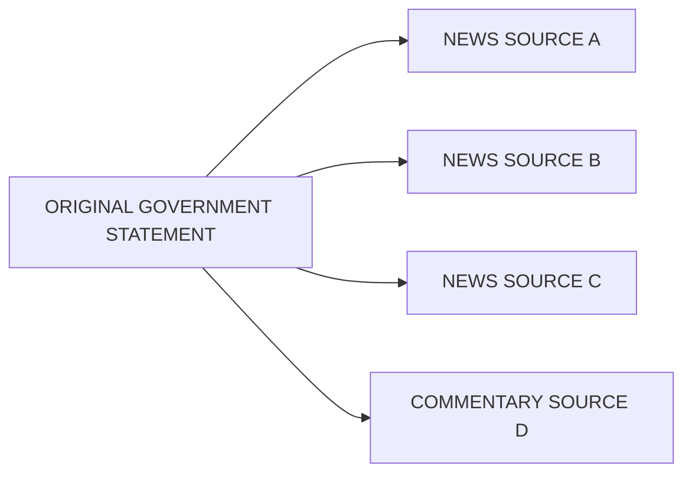
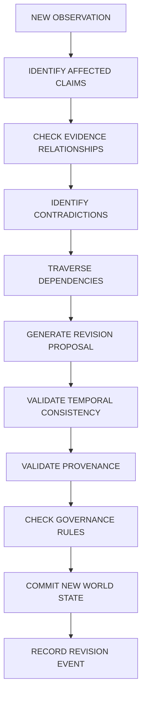

# Project Specification

**Reality Engine — Complete Project Specification and Technical Reference**
**Version:** 0.1.0 Specification
**Date:** November 1, 2026
**Author:** Daniel Kliewer
**Classification:** Open research and software architecture
**Implementation philosophy:** Local-first, evidence-grounded, temporally consistent, continuously revisable intelligence infrastructure.

---

## 1. Executive Summary

### 1.1 Project Definition

Reality Engine is a continuously operating computational system designed to construct, maintain, evaluate, and revise a global representation of the world using observations collected from heterogeneous information sources.

Its purpose is to create an evolving model of global reality that preserves the distinction between:

1. Immutable evidence and versioned interpretations.
2. Temporal knowledge representation.
3. Dependency-aware revision.
4. Specialized intelligence agents.
5. Deterministic governance and verification.
6. Local-first execution and model independence.
7. Historical reconstruction and measurable forecasting.

Reality Engine does not assume that available information represents reality completely or accurately. Instead, it maintains a versioned understanding derived from available observations, records the provenance of every significant assertion, identifies contradictory evidence, tracks uncertainty, and revises previous interpretations when new information becomes available.

### 1.2 Core Research Question

**How can an artificial intelligence system maintain a historically traceable, continuously updated computational representation of a complex external world despite incomplete observations, contradictory information, changing conditions, and uncertainty?**

Answer: By separating three independent representations — external reality, observation, and understanding — with explicit transformations between them, and by enforcing deterministic governance over all changes to the understanding.

### 1.3 Primary Design Principle

**Reality Engine must never confuse its understanding of reality with reality itself.** The system maintains an evidence-grounded model, not an assertion of omniscience. Its outputs must distinguish direct observations, source claims, interpretations, hypotheses, forecasts, and conclusions.

### 1.4 Intended Capabilities

Reality Engine will eventually support:

- Continuous global information collection.
- Structured observation extraction.
- Entity and event identification.
- Temporal knowledge representation.
- Cross-domain relationship discovery.
- Evidence provenance and source lineage.
- Contradiction detection.
- Belief revision.
- Dependency-aware world-state updates.
- Historical reconstruction.
- Uncertainty representation.
- Causal hypothesis tracking.
- Forecast generation and evaluation.
- Natural-language exploration of the world model.
- Interactive visualization of global developments.
- Independent verification of system operations.

---

## 2. Project Philosophy and Foundational Principles

### 2.1 Reality, Observation, and Understanding

The architecture is founded on three separate conceptual objects:

| Concept | Definition |
|---|---|
| **Reality** | The external environment, including physical processes, human activities, institutions, economic systems, natural systems, and digital infrastructure. |
| **Observation** | Information obtained about external reality. May be incomplete, delayed, inaccurate, contradictory, or incorrectly interpreted. |
| **Understanding** | The system's current computational representation of external reality, constructed from available observations. Provisional and revisable. |

The architecture must never allow an interpretation to overwrite its underlying observation.

### 2.2 The Mandatory Principles

| ID | Principle | Description |
|---|---|---|
| P1 | Evidence preservation | Original observations and source material must remain recoverable. |
| P2 | Provenance | Every factual assertion must have traceable provenance. |
| P3 | Temporal integrity | The system must distinguish when something happened from when it became known. |
| P4 | Revision rather than replacement | New information must revise previous understanding without silently erasing historical interpretations. |
| P5 | Explicit uncertainty | Unknown, disputed, unsupported, and contradicted information must remain distinguishable. |
| P6 | Source independence | Repeated reporting derived from a common origin must not be counted as independent corroboration. |
| P7 | Domain separation | Specialized world models must retain their own schemas while sharing a common ontology. |
| P8 | Deterministic governance | Language models may propose changes but must not directly control authoritative world-state transitions. |
| P9 | Reproducibility | Significant conclusions and revisions must be reconstructable from recorded inputs, model configurations, and processing versions. |
| P10 | Model independence | The knowledge infrastructure must not depend on a particular commercial LLM or inference provider. |
| P11 | Historical accountability | Previous interpretations, predictions, and errors must remain available for evaluation. |
| P12 | Observability awareness | The system must represent the limitations of its information environment. |

---

## 3. Scope

### 3.1 Global Scope

Reality Engine models interconnected global systems. The initial domain taxonomy consists of:

1. Geopolitical systems
2. Economic systems
3. Financial systems
4. Scientific systems
5. Technological systems
6. Environmental systems
7. Social and demographic systems
8. Military and security systems
9. Legal and institutional systems
10. Infrastructure and energy systems

These domains are logical divisions, not independent databases with incompatible representations. They share entities, events, observations, claims, and relationships.

### 3.2 Initial Scope

Version 0.1 focuses on the evidence foundation and a limited set of global information sources. Initial domains should include geopolitical, economic, and scientific systems.

### 3.3 Non-Goals

See NON_GOALS.md for the complete non-goals document.

---

## 4. System Architecture

### 4.1 Seven-Layer Architecture

The system is divided into seven logical layers:

| Layer | Name | Responsibility |
|---|---|---|
| 1 | External Reality | The environment being modeled. Conceptual only. |
| 2 | Observation Engine | Continuously gathers information. Source discovery, scheduled collection, API/RSS ingestion, data normalization, collection timestamps, source identification, duplicate detection. |
| 3 | Evidence Engine | Transforms source material into structured observations and claims. Claim extraction, entity identification, event extraction, source lineage, evidence relationships, contradiction detection, provenance preservation, evidence quality assessment. |
| 4 | World Model | Maintains the structured representation of global entities, events, conditions, and relationships. Seven domain models sharing a common ontology. |
| 5 | Revision Engine | Determines how new evidence affects existing understanding. Dependency-aware revision, contradiction analysis, temporal reconciliation, state transition validation, historical version preservation. |
| 6 | Intelligence Engine | Provides analytical capabilities. Six agents: Analyst, Skeptic, Historian, Forecaster, Verifier, Systems Integrator. |
| 7 | World Interface | Exposes the system to users. World Overview, World Explorer, Reality Timeline, Change Intelligence, Evidence Explorer, Ask Reality, Forecast Observatory, System Observatory. |

### 4.2 Component Separation

The implementation should initially use a modular monolith. Each subsystem has an independent internal interface but shares a common application runtime. Microservices are not required for the first implementation.

Subsystem boundaries must nevertheless be explicit so that components can be separated later if necessary.

### 4.3 High-Level Processing Architecture

```mermaid
flowchart LR
    EX["EXTERNAL INFORMATION SOURCES"] --> OE["OBSERVATION ENGINE"]
    OE --> NE["DOCUMENT NORMALIZATION"]
    NE --> EE["EVIDENCE ENGINE"]
    EE --> CE["CLAIM EXTRACTION"]
    CE --> ER["ENTITY RESOLUTION"]
    ER --> PE["PROVENANCE AND LINEAGE"]
    PE --> WM["WORLD MODEL"]
    WM --> RE["REVISION ENGINE"]
    RE --> DV["DETERMINISTIC VALIDATION"]
    DV --> AWS["ACCEPTED WORLD STATE"]
    AWS --> IE["INTELLIGENCE ENGINE"]
    IE --> UI["USER INTERFACE"]
    IE --> RE2
    RE2["REVISION ENGINE"] --> DV
```



All significant state transitions must produce audit events.

---

## 5. Observation Engine

### 5.1 Purpose

The Observation Engine continuously gathers information relevant to the global world model. It must support multiple source types through a common adapter interface.

### 5.2 Initial Source Categories

| Domain | Candidate Integrations |
|---|---|
| News and global events | GDELT, RSS feeds, official news organization feeds, government press releases, international organization announcements |
| Economics | FRED, World Bank, IMF, OECD, national statistical agencies, central bank publications |
| Science | Crossref, OpenAlex, arXiv, PubMed, institutional research repositories |
| Environment | NASA, NOAA, Copernicus, national meteorological agencies, public environmental datasets |
| Technology | GitHub API, public software release feeds, patent databases, research publications, standards organizations |
| Geopolitical and institutional information | United Nations, world trade organization, government publications, international treaty databases, official legislative records |

Connector availability, API restrictions, source licensing, and rate limits must be verified individually during implementation.

### 5.3 Source Adapter Interface

Every source adapter must implement a common interface:

```python
class SourceAdapter:
    def identify(self) -> SourceIdentity:
        ...

    def collect(self, cursor=None) -> CollectionBatch:
        ...

    def normalize(self, raw_item) -> NormalizedDocument:
        ...

    def checkpoint(self) -> CollectionCheckpoint:
        ...

    def health(self) -> AdapterHealth:
        ...
```

Adapters must support:

- Pagination
- Incremental collection
- Retry handling
- Rate limiting
- Duplicate detection
- Failure reporting
- Source-specific metadata
- Collection checkpoint persistence

### 5.4 Document Identity

Documents should have stable identities based on source identifiers where available. A content hash should also be generated. Identical content retrieved through multiple URLs should be recognized without discarding the individual source records.

Recommended fields:

- Document ID
- Source ID
- Source-native identifier
- Canonical URL
- Content hash
- Publication timestamp
- Collection timestamp
- Original language
- Content type
- Original content reference
- Processing status
- Source update frequency
- Domain importance
- Historical reliability
- Information freshness
- Resource cost
- Unresolved knowledge gaps

### 5.5 Collection Scheduling

Collection priority should be configurable. Potential factors:

- Source update frequency
- Domain importance
- Historical reliability
- Information freshness
- Resource cost
- Unresolved knowledge gaps

The scheduler must not allow one high-volume source to consume the entire processing budget.

---

## 6. Evidence Engine

### 6.1 Purpose

The Evidence Engine converts source documents into structured information while retaining the original material. Its primary output consists of observations, claims, entities, events, and evidence relationships.

### 6.2 Claim Classification

Each extracted claim must receive a type. Initial types:

| Type | Definition |
|---|---|
| Factual | Assertion about an event or condition |
| Reported | Assertion attributed to another source |
| Interpretive | Explanation or interpretation |
| Predictive | Assertion about a future outcome |
| Normative | Value judgment or recommendation |
| Hypothetical | Conditional proposition |
| Quantitative | Assertion involving measurable values |

The type determines how the claim may be evaluated. A prediction should not be evaluated using the same rules as a directly recorded measurement.

### 6.3 Evidence Relationships

Supported relationship types:

- SUPPORTS
- CONTRADICTS
- QUALIFIES
- DERIVED_FROM
- REPEATS
- ATTRIBUTED_TO
- SUPERSEDES
- CORROBORATES

Every relationship must contain its own provenance and, where applicable, an explanation of the inference.

### 6.4 Source Independence

The system must identify information lineage. For example:



The four downstream publications do not automatically represent four independent observations. The system must preserve publication diversity separately from evidentiary independence.

Source independence may be classified as:

- Independent
- Shared origin
- Partially dependent
- Unknown
- Not applicable

An unknown relationship must not be interpreted as independence.

### 6.5 Evidence Quality

Evidence quality should be multidimensional. Recommended attributes:

- Source authenticity
- Source expertise for the subject
- Directness
- Measurement quality

Do not collapse these into one universal reliability score. Domain-specific scoring may be introduced later, with explicit methodology.

### 6.6 Provenance Requirements

Every claim must be traceable to one or more source documents. Where possible, provenance should include:

- Source ID
- Document ID
- Original URL
- Relevant passage
- Page or paragraph location
- Extraction timestamp
- Extraction model
- Model version
- Extraction prompt version
- Validation status

A claim without provenance may exist as an explicitly unverified hypothesis, but it must not enter the verified factual state.

---

## 7. World Model

### 7.1 Common Ontology

The common ontology defines the fundamental objects shared across domains. Required object types:

1. Entity
2. Event
3. Observation
4. Claim
5. Evidence
6. Relationship
7. Condition
8. Hypothesis
9. Forecast
10. Conclusion

### 7.2 Entities

Entities represent identifiable objects in the world. Examples:

- Countries
- Governments
- Companies
- Institutions
- People
- Geographic regions
- Scientific organizations
- Infrastructure systems
- Technologies

Each entity must have a stable internal identifier. External identifiers should be stored as aliases rather than replacing internal identity.

Entity resolution must account for:

- Name changes
- Translations
- Abbreviations
- Duplicate identities
- Historical identities
- Organizational restructuring
- Geographic boundary changes

Ambiguous identity resolution must remain unresolved until sufficient evidence exists.

### 7.3 Events

Events represent occurrences. Examples:

- Elections
- Legislative decisions
- Natural disasters
- Economic announcements
- Scientific discoveries
- Corporate acquisitions
- Military developments
- Infrastructure failures

Events should support:

- Event identity
- Event type
- Description
- Participants
- Geographic scope
- Start and end time
- Reported time
- Evidence references
- Related events
- Event status

An event's occurrence time and reporting time must remain separate.

### 7.4 Relationships

Relationships connect entities, events, claims, and hypotheses. Initial relationship types:

- LOCATED_IN
- MEMBER_OF
- OWNS
- CONTROLS
- PARTICIPATES_IN

Additional relationship types:

- ANNOUNCED
- AFFECTS
- SUPPORTS
- CONTRADICTS
- PRECEDES
- FOLLOWS
- DEPENDS_ON
- CORRELATES_WITH
- CAUSES
- CAUSED_BY_HYPOTHESIS
- PREDICTS
- DERIVED_FROM

**DECIDED** — causal relationships require stronger evidence and explicit methodological justification than ordinary associations.

### 7.5 Domain Models

Each domain should implement specialized schemas:

| Domain | Key Objects |
|---|---|
| Geopolitical | States, governments, alliances, treaties, diplomatic relationships, territorial changes, conflicts, sanctions, political institutions |
| Economic | GDP, inflation, employment, interest rates, trade, production |
| Financial | Debt, consumption, monetary policy, fiscal policy, publications |
| Scientific | Publications, researchers, institutions, hypotheses, experimental results, replications, retractions, research domains |
| Technological | Companies, software projects, hardware, patents, technical capabilities, standards, research developments, releases |
| Environmental | Climate indicators, weather observations, ecosystems, natural resources, emissions, environmental events |
| Social | Demographics, population changes, education, public opinion |

Domain-specific schemas must remain extensible.

---

## 8. Temporal Architecture

### 8.1 Bitemporal Data Model

Every time-sensitive object must distinguish:

| Field | Meaning |
|---|---|
| valid_from | When the information applies to the external world |
| valid_to | When the information ceased to apply |
| recorded_at | When the system recorded the information |
| superseded_at | When the system replaced the information |

These fields must use consistent UTC timestamps. Unknown or approximate dates must be represented explicitly rather than invented.

### 8.2 Historical Reconstruction

The system must support two distinct queries. These queries must not produce interchangeable results.

| Query | Meaning |
|---|---|
| **Historical knowledge** | What did the system understand about the world at a particular historical date? (Uses only information available at that time.) |
| **Current understanding of the past** | What does the system currently understand about what was true at that historical date? (Uses all available current information.) |

All accepted world-state changes must create new versions. Earlier versions must remain recoverable. A historical record must never be silently modified to match current understanding.

### 8.3 Versioning

The actual implementation should use proper timestamp types and enforce interval semantics in the database rather than relying on string comparisons.

---

## 9. Revision Engine

The Revision Engine is the primary differentiating subsystem. Its responsibility is to identify how new evidence changes the system's existing understanding. It must perform dependency-aware revision rather than simple information accumulation.

### 9.1 Revision Pipeline



### 9.2 Revision Triggers

A revision may be triggered by:

- New evidence
- Corrected source data
- Source retraction
- New observation
- Entity identity correction
- Changed event date
- Contradictory measurement
- New scientific replication
- Invalidated hypothesis
- Changed domain schema
- Updated extraction or interpretation methodology

### 9.3 Revision Outcomes

Every revision proposal must produce an explicit outcome. Supported outcomes:

| Outcome | Meaning |
|---|---|
| NEW_INFORMATION | New evidence requiring review |
| SUPPORTED | Existing claim is supported |
| PARTIALLY_SUPPORTED | Some evidence supports, some challenges |
| CHALLENGED | Existing claim is challenged |
| CONTRADICTED | Existing claim is contradicted |
| SUPERSEDED | Replaced by a newer version |
| WITHDRAWN | Explicitly withdrawn |
| UNRESOLVED | Cannot be resolved |
| NO_CHANGE | No effect on current understanding |

A proposal may be rejected. Rejection must preserve the proposal and the reason for rejection.

### 9.4 Dependency Graph

The system must maintain explicit dependencies between conclusions. Example:

```text
H1: Energy supply is declining.
H2: Energy prices will increase.
H3: Industrial production will decline.
H4: Inflationary pressure will increase.
```

When new evidence challenges the original observation, downstream hypotheses should be flagged for reassessment. The system must not automatically reverse every downstream conclusion. Each dependent claim must be independently evaluated against its remaining evidence.

### 9.5 Revision Algorithm (Pseudocode)

```python
def process_revision(observation):
    affected = identify_directly_affected_claims(observation)
    dependency_set = traverse_dependencies(affected)
    proposals = []
    for item in dependency_set:
        proposal = generate_revision_proposal(
            item=item,
            new_observation=observation,
            evidence=load_related_evidence(item),
            dependencies=load_dependencies(item)
        )
        proposals.append(proposal)
    validated = validate_revision_proposals(proposals)
    return commit_revision_transaction(validated)
```

The actual implementation must include:

- Idempotency
- Transaction boundaries
- Cycle detection
- Revision ordering
- Conflict handling
- Failure recovery
- Dependency version checks
- Audit event generation

---

## 10. Epistemic and Uncertainty Model

### 10.1 Fundamental Requirement

The system must distinguish what is known, what is reported, what is inferred, and what remains unknown. No single confidence score is sufficient to represent all uncertainty.

### 10.2 Epistemic Dimensions

Each significant claim may carry:

- Source reliability (how dependable is the source for this type of information?)
- Directness (is the evidence direct or secondhand?)
- Corroboration (are there genuinely independent sources?)
- Temporal validity (is the information current?)
- Measurement quality (how reliable is the underlying measurement?)
- Interpretation (how much inference is required?)
- Contradiction (what evidence challenges the claim?)
- Completeness (what important information is missing?)

These dimensions should remain independently inspectable. The system may optionally calculate confidence estimates, but the methodology must be explicit and domain-specific.

### 10.3 Evidence Status

Recommended statuses:

| Status | Meaning |
|---|---|
| UNASSESSED | Not yet evaluated |
| SUPPORTED | Evidence supports the claim |
| PARTIALLY_SUPPORTED | Some evidence supports, some challenges |
| CONTESTED | Competing claims exist |
| CONTRADICTED | Evidence directly challenges the claim |
| UNRESOLVED | Insufficient evidence to decide |
| SUPERSEDED | Replaced by a newer version |
| WITHDRAWN | Explicitly withdrawn |

The status is an assessment of available evidence, not an assertion of metaphysical certainty.

### 10.4 Unknown States

The system must explicitly represent:

1. Evidence supports occurrence.
2. Evidence supports non-occurrence.
3. Evidence conflicts.
4. No relevant observation exists.
5. Available information is insufficient.

These must never be collapsed into a binary true/false value.

### 10.5 Bayesian Analysis

Bayesian updating may be used for suitable probabilistic hypotheses. The system must document:

- Prior assumptions
- Likelihood model
- Evidence dependencies
- Conditional independence assumptions
- Update calculations
- Model version

Bayesian calculations must not be applied to arbitrary claims without defensible probability models.

---

## 11. Source Lineage and Information Independence

### 11.1 Purpose

Source lineage prevents repeated information from being mistaken for independent confirmation.

### 11.2 Requirements

The system must track:

- The original source
- Republishing sources
- Quoted sources
- Syndicated reporting
- Common datasets
- Shared research origins
- Independent measurements

### 11.3 Lineage Graph

Source relationships must be represented independently from claim relationships. A source may derive from another source without making every claim identical. The graph should support partial dependence and unknown dependence.

### 11.4 Evaluation

Create benchmark datasets containing:

- Ten publications repeating one original claim
- Several independent observations supporting the same claim
- Multiple sources reporting conflicting values
- Documents quoting one another without additional verification

The system must correctly distinguish these cases.

---

## 12. Intelligence Engine

### 12.1 Architecture

The Intelligence Engine uses specialized, task-driven agents. Agents are not authoritative databases. They produce structured analytical proposals that must be validated before affecting the accepted world model.

### 12.2 Analyst

**Responsibilities:** Interpret observations, extract candidate relationships, identify patterns, generate hypotheses, explain developments, find contradictory evidence.

**Outputs:** Must include evidence references and uncertainty.

### 12.3 Skeptic

**Responsibilities:** Find contradictory evidence, identify unsupported assumptions, detect alternative explanations, challenge weak inferences, identify missing information.

**Outputs:** Must include evidence references and uncertainty.

The Skeptic should be independently prompted and evaluated. Its agreement with another model does not constitute verification.

### 12.4 Historian

**Responsibilities:** Retrieve historical context, compare previous events, identify recurring patterns, track previous interpretations, identify historical differences.

**Outputs:** Must include evidence references and uncertainty.

Historical similarity must not automatically be interpreted as causal equivalence.

### 12.5 Forecaster

**Responsibilities:** Generate testable predictions, record probabilities, define outcome conditions, specify evaluation horizons, track forecast performance.

**Key constraint:** Every forecast must be immutable after publication except through an explicit correction record.

### 12.6 Verifier

**Responsibilities:** Check provenance, validate schema compliance, verify source references, check temporal consistency, detect unsupported assertions, validate revision requirements.

**Requirements:** The Verifier should use deterministic validation wherever possible.

### 12.7 Systems Integrator

**Responsibilities:** Coordinate analytical tasks, collect agent outputs, generate revision proposals, resolve schema and dependency conflicts, submit proposals to the deterministic revision engine.

**Key constraint:** It must not directly write authoritative world-state records.

### 12.8 Execution Model

Agents should be invoked when tasks require them. Do not run every agent continuously. The scheduler should use task complexity, uncertainty, novelty, and resource cost to determine which agents are needed.

- Routine extraction should use inexpensive local models.
- More capable reasoning models should be reserved for difficult interpretation and revision problems.

---

## 13. Active World Observation

### 13.1 Purpose

Reality Engine should eventually identify gaps in its understanding and determine which additional observations would be most useful.

### 13.2 Knowledge Gaps

Examples:

- A major economic indicator has not been updated.
- Two official datasets disagree.
- A reported event lacks independent confirmation.
- A critical entity has incomplete historical records.
- A hypothesis depends on an outdated measurement.
- A source has stopped publishing.

### 13.3 Observation Priority

A proposed priority model:

```text
Observation Priority =
    Potential Information Value
  × Uncertainty Reduction
  × Domain Relevance
  × Time Sensitivity
  / Collection Cost
```

This is an initial heuristic, not a statistically validated formula. The system should eventually measure whether acquiring the suggested information actually improves its world model.

### 13.4 Autonomous Collection Boundaries

The observation engine may autonomously collect from approved public sources within defined limits. It must not:

- Bypass access controls
- Circumvent paywalls
- Violate source terms

---

## 14. Forecasting and Predictive Analysis

### 14.1 Purpose

Forecasting is a secondary capability built on top of the world model. The system should be able to generate predictions based on explicitly defined hypotheses.

### 14.2 Forecast Object

Each forecast must include:

- Forecast ID
- Hypothesis
- Predicted outcome
- Probability
- Time horizon
- Evaluation criteria (resolution criteria)
- Supporting evidence
- Assumptions
- Creation timestamp
- Model configuration
- Evaluation timestamp
- Actual outcome
- Scoring result

### 14.3 Forecast Evaluation

For binary forecasts, use the Brier score:

$$BS = \frac{1}{N}\sum_{i=1}^{N}(p_i - o_i)^2$$

Where:

- $p_i$ is the predicted probability.
- $o_i$ is the observed outcome, either 0 or 1.

For suitable continuous forecasts, use appropriate proper scoring rules.

The system should compare forecasts against:

- Different models
- Different forecasting agents
- Human forecasters
- Different information sets
- Different forecasting methodologies

### 14.4 Forecast Calibration

Measure whether predictions assigned a particular probability occur at approximately that frequency over a sufficiently large sample. A model repeatedly predicting 80% probability should not be considered calibrated if such events occur only 40% of the time.

### 14.5 Historical Accountability

Forecasts must not be silently rewritten. Corrections require separate records. All evaluation results must remain historically accessible.

---

## 15. Observability Model

### 15.1 Purpose

The system must model the limitations of its own information environment. It must distinguish:

- What it can observe
- What it can partially observe
- What it cannot directly observe
- What it has not yet collected
- What remains unknown

### 15.2 Domain Observability

Example for domain: international_trade:

```yaml
observable:
  - published_trade_statistics
  - customs_data_where_available
  - shipping_movements
  - official_trade_announcements
partially_observable:
  - informal_trade
  - private_commercial_agreements
  - unreported_transactions
not_directly_observable:
  - undisclosed_negotiations
  - private_decision_making
known_limitations:
  - reporting_delays
  - missing_datasets
  - geographic_coverage_gaps
  - measurement_differences
```

### 15.3 Observability Metrics

Track:

- Source coverage
- Geographic coverage
- Temporal coverage
- Update frequency
- Missing data
- Data quality
- Known reporting delays
- Entity resolution completeness

A global coverage percentage should not be presented without defining how it was calculated.

---

## 16. Database Architecture

### 16.1 Initial Technology

| Component | Technology |
|---|---|
| Primary storage | SQLite |
| Database mode | WAL (Write-Ahead Logging) |
| Foreign-key enforcement | On |
| Full-text search | FTS5 |
| Data validation | Pydantic |
| API | FastAPI |
| Background processing | Python task workers |
| Testing | pytest |
| Optional performance components | Rust (for hot paths) |

### 16.2 Required Tables

The core tables are:

| Table | Purpose |
|---|---|
| sources | Source identities and characteristics |
| documents | Original collected material |
| observations | Extracted or measured observations |
| claims | Normalized assertions |
| evidence_links | Support and contradiction relationships |
| entities | Countries, organizations, people, systems |
| entity_aliases | Alternate names for entities |
| events | Occurrences in the world |
| relationships | Connections between entities |
| hypotheses | Explanatory models |
| forecasts | Predictions and evaluation conditions |
| world_states | Versioned state snapshots |
| revision_events | Every proposed and accepted revision |
| dependencies | Relationships between conclusions |
| source_lineage | Shared origins and information propagation |
| forecasts | Predictions and evaluation conditions |
| audit_events | Audit trail of significant operations |

### 16.3 Database Integrity

Required controls:

- Foreign-key constraints
- Unique identity constraints
- Transactional revision commits
- Immutable evidence records
- Explicit correction records
- Schema migrations
- Consistent timestamps
- Idempotency keys
- Database backup and recovery

A hash chain may be used to detect alteration of audit history. A hash chain alone does not guarantee tamper resistance if an attacker controls the database and all associated keys. External checkpoints or independently stored signatures may be introduced later.

---

## 17. Application Programming Interfaces

The API should be versioned from the beginning. Initial prefix: `/api/v1/`

### 17.1 Source Endpoints

| Method | Path | Description |
|---|---|---|
| GET | /sources | List sources |
| GET | /sources/{id} | Get a source |
| POST | /sources | Create a source |
| PATCH | /sources/{id} | Update a source |
| GET | /sources/{id}/health | Source health check |

### 17.2 Document Endpoints

| Method | Path | Description |
|---|---|---|
| GET | /documents | List documents |
| GET | /documents/{id} | Get a document |

### 17.3 Observation Endpoints

| Method | Path | Description |
|---|---|---|
| GET | /observations | List observations |
| GET | /observations/{id} | Get an observation |
| POST | /observations | Create an observation |
| GET | /observations/{id}/related | Related observations |

### 17.4 Claim Endpoints

| Method | Path | Description |
|---|---|---|
| GET | /claims | List claims |
| GET | /claims/{id} | Get a claim |
| GET | /claims/{id}/evidence | Claim evidence |
| GET | /claims/{id}/history | Claim revision history |
| GET | /claims/{id}/dependencies | Claim dependencies |
| GET | /documents/{id}/claims | Claims in a document |
| GET | /documents/{id}/provenance | Provenance for a document |

### 17.5 Entity Endpoints

| Method | Path | Description |
|---|---|---|
| GET | /entities | List entities |
| GET | /entities/{id} | Get an entity |
| GET | /entities/{id}/relationships | Entity relationships |
| GET | /entities/{id}/timeline | Entity timeline |
| GET | /entities/{id}/state | Entity state |

### 17.6 Event Endpoints

| Method | Path | Description |
|---|---|---|
| GET | /events | List events |
| GET | /events/{id} | Get an event |
| GET | /events/{id}/related | Related events |

### 17.7 World State Endpoints

| Method | Path | Description |
|---|---|---|
| GET | /world/state | Current world state |
| GET | /world/state/{version} | World state at a version |
| GET | /world/history | Historical understanding |
| GET | /world/changes | Recent changes |
| POST | /world/query | Structured world query |

### 17.8 Revision Endpoints

| Method | Path | Description |
|---|---|---|
| GET | /revisions | List revisions |
| GET | /revisions/{id} | Get a revision |
| GET | /revisions/{id}/dependencies | Revision dependencies |
| GET | /revisions/{id}/audit | Revision audit trail |
| POST | /revisions/{id}/validate | Validate a revision |

### 17.9 Intelligence Endpoints

| Method | Path | Description |
|---|---|---|
| POST | /intelligence/analyze | Agent analysis |
| POST | /intelligence/compare | Compare agents |
| POST | /intelligence/explain | Explain a conclusion |
| POST | /intelligence/query | Query the model |

### 17.10 Forecasting Endpoints

| Method | Path | Description |
|---|---|---|
| GET | /forecasts | List forecasts |
| GET | /forecasts/{id} | Get a forecast |
| POST | /forecasts | Create a forecast |
| GET | /forecasts/{id}/evaluation | Forecast evaluation |

### 17.11 Error Handling

All errors must follow a consistent error model (defined in API_ERROR_MODEL.md).

---

## 18. User Interface

### 18.1 Design Objective

The interface should resemble a global research and intelligence environment rather than a conventional chatbot. It should expose the underlying model and allow users to investigate how conclusions were reached.

### 18.2 Main Navigation

Required sections:

1. World Overview
2. World Explorer
3. Reality Timeline
4. Change Intelligence
5. Evidence Explorer
6. Ask Reality
7. Forecast Observatory
8. System Observatory
9. Administration

### 18.3 World Overview

Display:

- Major global developments
- Recently revised world-state assessments
- Domain-level changes
- Emerging developments
- Significant unresolved questions
- Information coverage limitations

The dashboard should distinguish newly reported events from actual changes in established world-state assessments. Rankings must explain their methodology. Do not confuse news volume with importance.

### 18.4 World Explorer

An interactive map and graph interface. Selecting a country, company, institution, or event must expose its provenance and revision history.

### 18.5 Reality Timeline

A historical reconstruction interface. Support:

- Historical date selection
- Historical state reconstruction
- Observation chronology
- Knowledge chronology
- Revision chronology
- Comparison between historical and current understanding

### 18.6 Change Intelligence

Show changes rather than merely showing new documents. Each change report should include:

- Changed object
- Previous state
- New state
- Triggering evidence
- Related claims
- Downstream dependencies
- Revision status
- Remaining uncertainty

### 18.7 Evidence Explorer

Allow users to inspect:

- Original source
- Extracted passage
- Evidence
- Hypotheses
- Revision history

### 18.8 Ask Reality

Natural-language questions should be translated into structured queries against the world model. The query engine must retrieve evidence before generating an answer.

Example: "What has changed in global energy markets during the last 30 days?"

The system should:

1. Resolve the requested date range.
2. Identify relevant entities and events.
3. Retrieve relevant observations.
4. Compare historical world-state versions.
5. Identify changed claims.
6. Retrieve supporting evidence.
7. Generate a structured explanation.

The LLM must not invent missing observations or silently fill gaps.

### 18.9 System Observatory

Expose operational health:

- Collection status
- Source failures
- Processing queues
- Revision backlog
- Model utilization
- Database size
- Failed validation
- Data coverage

This is essential for operating a continuously updating system.

---

## 19. Technology Stack

### 19.1 Primary Stack

| Component | Technology |
|---|---|
| Core application | Python |
| Database | SQLite |
| Database mode | WAL |
| Full-text search | FTS5 |
| Data validation | Pydantic |
| API | FastAPI |
| Background processing | Python task workers |
| Interface | React and TypeScript |
| Visualization | D3.js or equivalent |
| Local inference | Ollama |
| Alternative inference | llama.cpp |
| Embeddings | Local embedding models |
| Optional performance components | Rust |
| Testing | pytest |
| Schema migrations | Versioned migration framework |

Versions should be pinned in the implementation repository after compatibility testing.

### 19.2 Model Abstraction

All inference must pass through a common model interface:

```python
class ModelProvider:
    def generate(self, request):
        ...

    def embed(self, request):
        ...

    def health(self):
        ...

    def capabilities(self):
        ...
```

The application must not depend directly on a single provider's proprietary request format. The system should support replacing any model without changing the underlying data model.

### 19.3 Model Selection

Use different model classes for different tasks:

| Task | Preferred Model Capability |
|---|---|
| Entity extraction | Small instruction model |
| Claim extraction | Structured-output model |
| Classification | Small local model |
| Relationship discovery | Reasoning-capable model |
| Contradiction analysis | Independent reasoning model |
| Historical synthesis | Long-context model |
| Final explanation | Instruction-following model |

### 19.4 Hardware Considerations

The initial system should be capable of running on a modern Apple Silicon workstation with approximately 48 GB unified memory.

Resource-intensive tasks should be queued. Large global ingestion workloads should not require all documents to remain in model context.

Batch processing, caching, incremental indexing, and compact intermediate representations are mandatory.

---

## 20. Security and Governance

### 20.1 Fundamental Security Model

External information is untrusted input. Documents, websites, extracted text, and model-generated content must never be treated as executable instructions.

Prompt injection must be treated as a data-ingestion threat.

### 20.2 Model Permissions

LLMs may:

- Read authorized information
- Generate candidate observations
- Propose claims
- Suggest relationships
- Generate hypotheses
- Propose revisions

LLMs may not independently:

- Modify immutable evidence
- Delete audit records
- Override validation
- Grant themselves permissions
- Directly change accepted world state
- Execute arbitrary external actions

### 20.3 Frozen Spine Integration

Frozen Spine should provide the authorization and execution boundary. The model proposes an operation. The deterministic control plane validates:

- Actor
- Requested operation
- Resource
- Permission

The operation is either accepted or rejected. The resulting decision is recorded.

### 20.4 Security Requirements

- Preconditions
- Schema
- Execution policy
- Least-privilege permissions
- Sandboxed document processing
- Safe file handling
- Credential isolation
- API rate limits
- Input validation
- Dependency auditing
- Signed software releases
- Backup and recovery
- Audit history
- Controlled external network access

### 20.5 Privacy

The initial application should prioritize public information. Private data integrations must require explicit authorization and appropriate access controls. Public and private information should have separate access boundaries.

---

## 21. Event Sourcing and Audit Architecture

### 21.1 Event Types

The system should record events such as:

- SOURCE_REGISTERED
- DOCUMENT_COLLECTED
- DOCUMENT_UPDATED
- OBSERVATION_EXTRACTED
- CLAIM_CREATED
- CLAIM_SUPPORTED
- CLAIM_CHALLENGED
- ENTITY_CREATED
- ENTITY_RESOLVED
- RELATIONSHIP_CREATED
- HYPOTHESIS_CREATED
- REVISION_PROPOSED
- REVISION_VALIDATED
- REVISION_REJECTED
- WORLD_STATE_UPDATED
- FORECAST_CREATED
- FORECAST_EVALUATED
- SCHEMA_MIGRATED

### 21.2 Event Immutability

Events must be append-only. Corrections require new events. A previous event must not be silently rewritten.

### 21.3 Replay

The system should support rebuilding derived world-state projections from recorded events. Replay must account for versioned interpretation logic.

If an extraction or inference model changes, the system must distinguish:

- Replaying the original accepted history (exact)
- Reprocessing source material with a newer methodology (not exact)

### 21.4 Reproducibility

Record:

- Model identifier
- Model version
- Prompt version
- Schema version
- Software version

Exact reproduction may not always be possible with nondeterministic model inference. The system must preserve original outputs and distinguish reproducibility from deterministic replay.

---

## 22. Testing and Evaluation

### 22.1 Testing Philosophy

Reality Engine must be evaluated on the correctness of its knowledge operations, not the fluency of its generated explanations. A convincing answer is not necessarily a correct answer.

### 22.2 Core Benchmark Categories

| Benchmark | Measurement |
|---|---|
| Extraction | Claim extraction precision, recall, entity extraction accuracy, event extraction accuracy, temporal extraction accuracy |
| Provenance | Percentage of claims traceable to correct original source passages |
| Temporal integrity | Delayed reporting, corrected publication dates, retroactive policy changes |
| Revision | Correctly affected claims, incorrectly affected claims, missed dependencies, invalid revision acceptance, unnecessary revision frequency |
| Source independence | Syndicated articles, repeated press releases, independent measurements, shared research sources, quoted secondary sources |
| Contradiction detection | Genuine contradictions, apparent contradictions caused by different time periods, different units, different definitions, different geographic scopes, incomplete reporting |
| Forecast calibration | Accuracy against proper scoring rules and baseline models |

### 22.3 Adversarial Test Cases

The test suite must include:

1. A false initial report later corrected
2. Multiple publications repeating one unsupported claim
3. Conflicting government datasets
4. A scientific paper subsequently retracted
5. An entity incorrectly identified
6. An event reported significantly after occurrence
7. A misleading correlation
8. A source containing malicious prompt instructions
9. An economic indicator revised retroactively
10. A hypothesis invalidated by new evidence

### 22.4 Acceptance Targets

| Metric | Initial Target |
|---|---|
| Provenance coverage | 100% of accepted factual claims |
| Duplicate processing | Idempotent |
| Historical replay | Exact for deterministic recorded events |
| Temporal validation | 100% of committed records pass schema rules |
| Unauthorized state transitions | Zero |
| Evidence preservation | No silent destructive updates |
| Revision auditability | 100% of accepted revisions |
| Hindsight contamination | Zero in controlled benchmark tests |

Model accuracy targets should be established separately for each domain and task after baseline measurements.

---

## 23. Performance and Scalability

### 23.1 Initial Design

The first version should optimize for correctness and traceability rather than maximum ingestion volume.

### 23.2 Performance Requirements

- Incremental collection
- Batch document processing
- Asynchronous task execution
- Deduplication before expensive inference
- Cached extraction results
- Indexed temporal queries
- Indexed entity relationships
- Bounded context retrieval
- Background projection rebuilding

### 23.3 Database Growth

Large source documents should be stored outside frequently queried relational records when appropriate. The database should retain content references, hashes, and metadata.

### 23.4 Future Scaling

If the project outgrows SQLite, introduce components based on measured requirements. Potential additions:

- PostgreSQL for concurrent transactional workloads
- Dedicated graph storage
- DuckDB for analytical processing
- Specialized vector storage
- Message queues
- Distributed ingestion workers
- Object storage

No migration should be performed simply because a technology is fashionable.

---

## 24. Repository Architecture

### 24.1 Recommended Initial Repository

```
reality-engine/
├── README.md
├── LICENSE
├── CONTRIBUTING.md
├── pyproject.toml
├── package.json
├── .env.example
├── .gitignore
│
├── docs/
│   ├── PROJECT_SPECIFICATION.md
│   ├── ARCHITECTURE.md
│   ├── ONTOLOGY.md
│   ├── REVISION_MODEL.md
│   ├── TEMPORAL_MODEL.md
│   ├── EPISTEMIC_MODEL.md
│   ├── SECURITY.md
│   ├── API.md
│   ├── BENCHMARKS.md
│   └── DECISIONS/
│
├── core/
│   ├── ontology/
│   ├── entities/
│   ├── events/
│   ├── relationships/
│   ├── temporal/
│   ├── world_state/
│   ├── revision/
│   └── event_ledger/
│
├── observation/
│   ├── adapters/
│   ├── collectors/
│   ├── scheduler/
│   ├── normalization/
│   └── deduplication/
│
├── evidence/
│   ├── extraction/
│   ├── claims/
│   ├── provenance/
│   ├── lineage/
│   ├── contradiction/
│   └── verification/
│
├── intelligence/
│   ├── analyst/
│   ├── skeptic/
│   ├── historian/
│   ├── forecaster/
│   ├── verifier/
│   └── integrator/
│
├── domains/
│   ├── geopolitical/
│   ├── economic/
│   ├── financial/
│   ├── scientific/
│   ├── technological/
│   ├── environmental/
│   ├── social/
│   ├── security/
│   ├── legal/
│   └── infrastructure/
│
├── governance/
│   ├── policies/
│   ├── permissions/
│   ├── frozen_spine/
│   └── audit/
│
├── storage/
│   ├── sqlite/
│   ├── documents/
│   ├── indexes/
│   ├── migrations/
│   └── projections/
│
├── api/
│   ├── routes/
│   ├── schemas/
│   └── services/
│
├── frontend/
│   ├── src/
│   ├── pages/
│   ├── explorer/
│   ├── timeline/
│   ├── evidence/
│   ├── intelligence/
│   └── observatory/
│
├── evaluation/
│   ├── datasets/
│   ├── extraction/
│   ├── provenance/
│   ├── temporal/
│   ├── revision/
│   ├── forecasting/
│   └── adversarial/
│
├── scripts/
├── migrations/
└── tests/
```

The structure is a target architecture. Directories should be introduced as their functionality is implemented.

---

## 25. Development Milestones

### Milestone 0: Architecture and Ontology

**Deliverables:**

- All core objects can be represented without depending on an LLM.
- Final ontology specification
- Core object definitions
- Database schema
- Temporal model
- Event model
- Source adapter interface
- Revision state machine
- Initial architecture decision records

**Acceptance:**

- All core objects can be represented without depending on an LLM.

### Milestone 1: Reality Engine 0.1 (Evidence Foundation)

**Deliverables:**

- SQLite database
- Source registry
- RSS ingestion
- Initial API ingestion
- Document archive
- Content hashing
- Claim extraction
- Entity extraction
- Provenance records
- Basic search
- Entity registry
- Event registry
- Relationship model
- Bitemporal storage
- Historical state snapshots
- Historical query interface

**Acceptance:**

- A user can ingest a document, inspect extracted claims, and trace every accepted claim to the original document.

### Milestone 2: Reality Engine 0.2 (Temporal World Model)

**Deliverables:**

- SQLite database
- Source registry
- RSS ingestion
- Initial API ingestion
- Document archive
- Content hashing
- Claim extraction
- Entity extraction
- Provenance records
- Basic search
- Entity registry
- Event registry
- Relationship model
- Bitemporal storage
- Historical state snapshots
- Historical query interface

**Acceptance:**

- The system can reconstruct both historical knowledge and current understanding of historical conditions.

### Milestone 3: Reality Engine 0.3 (Revision Engine)

**Deliverables:**

- Contradiction detection
- Evidence lineage
- Dependency graph
- Revision proposals
- Deterministic validation
- Transactional state updates
- Audit history

**Acceptance:**

- A new observation can trigger a controlled revision of affected claims while preserving unaffected state and previous interpretations.

### Milestone 4: Reality Engine 0.4 (Global Intelligence)

**Deliverables:**

- Contradiction detection
- Evidence lineage
- Dependency graph
- Revision proposals
- Deterministic validation
- Transactional state updates
- Audit history
- Analyst, Skeptic, Historian, Verifier agents
- Cross-domain relationship discovery
- Change reports
- Natural-language querying

**Acceptance:**

- Users can investigate a development across multiple domains and inspect the evidence behind each conclusion.

### Milestone 5: Reality Engine 0.5 (Predictive World Model)

**Deliverables:**

- Forecast objects
- Evaluation criteria
- Outcome collection
- Forecasting pipeline
- Evaluation reporting

**Acceptance:**

- Forecasts can be evaluated against actual outcomes without changing their original published probabilities.

### Milestone 6: Reality Engine 1.0 (Global Reality Interface)

**Deliverables:**

- Interactive global world model
- Historical timeline
- Evidence explorer
- Change intelligence
- Forecast explorer
- Public API

**Acceptance:**

- An independent user can follow a global development from original observations through claim extraction, evidence relationships, revision, and final world-state assessment.

---

## 26. Operational Requirements

### 26.1 Installation

The application should support local installation with documented prerequisites. A single development command should start the core services where practical.

### 26.2 Configuration

Configuration should support:

- Database location
- Document storage location
- Enabled source adapters
- Collection intervals
- Model providers
- Model selection
- Processing limits
- Domain settings
- Governance policies

Secrets must be stored outside source control.

### 26.3 Logging

Logs should distinguish:

- Logging levels
- Collection operations
- Extraction operations
- Inference operations
- Revision proposals
- Accepted revisions
- Rejected revisions
- Validation failures
- Database errors

### 26.4 Recovery

The system must support:

- Database backups
- Document archive recovery
- Failed task retries
- Processing checkpoint recovery
- Event replay
- Projection rebuilding

### 26.5 Maintenance

Provide tools to:

- Inspect source health
- Reprocess documents
- Rebuild search indexes
- Validate provenance
- Detect orphaned records
- Reconcile entity identities
- Audit world-state dependencies

---

## 27. Documentation Requirements

The project must maintain the following documentation:

1. Project specification
2. Architecture overview
3. Ontology reference
4. Database schema
5. Temporal model
6. Revision algorithm
7. Evidence and provenance model
8. Epistemic model
9. API reference
10. Security model
11. Source adapter development guide
12. Intelligence agent development guide
13. Evaluation methodology
14. Installation guide
15. Operations guide
16. Research papers and technical reports

---

## 28. Research Contributions

Reality Engine should be developed as both software and an evolving research program.

| Research Contribution | Description |
|---|---|
| R1. Temporal World-State Representation | A bitemporal representation that separates external event time from system knowledge time |
| R2. Dependency-Aware Belief Revision | An architecture for revising connected conclusions when new evidence challenges existing observations or hypotheses |
| R3. Evidence Lineage and Independence | A computational model for identifying common information origins and preventing duplicate reporting from artificially increasing evidentiary confidence |
| R4. Observability-Aware Intelligence | A method for explicitly representing gaps and limitations in a system's information environment |
| R5. Verifiable AI-Generated World-State Transitions | A reference architecture in which LLMs propose knowledge changes but deterministic systems control accepted state transitions |
| R6. Historical Knowledge Reconstruction | A reproducible method for reconstructing what a computational intelligence system knew and understood at any recorded historical checkpoint |
| R7. Active World Observation | A mechanism for identifying which additional observations would most improve the system's understanding |

These should be treated as research hypotheses and implementation objectives until demonstrated through experiments.

---

## 29. Risks and Mitigations

| Risk | Mitigation |
|---|---|
| Information overload | Domain prioritization and incremental processing |
| Hallucinated claims | Source-grounded extraction and validation |
| Duplicate reporting | Source lineage |
| Incorrect entity resolution | Stable identities and ambiguity handling |
| False causal inference | Explicit causal methodology |
| Historical contamination | Bitemporal records and replay tests |
| Model bias | Multiple analytical perspectives and evidence-first evaluation |
| Model drift | Versioned models and regression tests |
| Database complexity | Modular monolith and incremental schema growth |
| Computational cost | Local models, batching, caching |
| Source instability | Adapter health monitoring and multiple sources |
| Malicious documents | Treat all external content as untrusted data |
| Silent knowledge corruption | Immutable evidence and audit events |
| Overconfident outputs | Explicit uncertainty and observability |

---

## 30. Open Architectural Decisions

The following questions should be resolved through prototypes and benchmarks rather than prematurely fixed:

| ID | Decision | Initial Recommendation |
|---|---|---|
| OD-001 | Graph representation | SQLite relational tables with graph projections |
| OD-002 | Event processing | Embedded task processing |
| OD-003 | Belief revision methodology | Hybrid architecture with explicit evidence relationships and deterministic revision rules |
| OD-004 | Ontology evolution | Versioned ontology schemas and explicit migration events |
| OD-005 | Source evaluation | Domain-specific, multidimensional source assessment |
| OD-006 | Model independence | Provider-neutral structured request and response contracts |
| OD-007 | Distributed execution | Only after measured bottlenecks |
| OD-008 | Global coverage | Domain-specific observability metrics rather than a single global completeness score |

---

## 31. Definition of Done

### Reality Engine 1.0

The system is complete when:

**Evidence:**

- Original source material is preserved.
- Claims have traceable provenance.
- Duplicate information is recognized.
- Source lineage is inspectable.

**World Model:**

- Entities have stable identities.
- Events are temporally represented.
- Relationships are typed.
- Domain models share a common ontology.

**Revision:**

- New evidence can challenge existing claims.
- Dependencies are traversable.
- Revision proposals are validated.
- Historical versions remain accessible.
- Invalid revisions are rejected and recorded.

**Intelligence:**

- Specialized agents produce structured outputs.
- Unsupported claims are identified.
- Contradictions are surfaced.
- Forecasts are explicitly measurable.

**User Experience:**

- Users can explore the global model.
- Users can inspect evidence.
- Users can reconstruct historical understanding.
- Users can see what changed.
- Users can query the system without losing access to underlying evidence.

**Governance:**

- All accepted revisions are auditable.
- External information is treated as untrusted.
- The system's own limitations are represented.

**Evaluation:**

- Extraction benchmarks exist.
- Provenance benchmarks exist.
- Temporal benchmarks exist.
- Revision benchmarks exist.
- Hindsight contamination tests pass.
- Forecast evaluation is operational.

---

## 32. Final Architectural Position

Reality Engine is a continuously revisable computational model of global reality, constructed from incomplete and heterogeneous observations.

Its primary responsibility is not to generate answers. Its responsibility is to maintain a defensible, historically traceable representation of what is currently understood about the world, explain how that understanding was constructed, identify where it is uncertain, and revise it when new information warrants a change.

The architecture separates:

- External reality from observation
- Observation from interpretation
- Interpretation from accepted world state
- Model-generated proposals from deterministic authorization
- Historical knowledge from current knowledge
- Correlation from causation
- Evidence from repetition
- Uncertainty from absence of information

New sources can be added without changing the ontology. New domains can be introduced without replacing existing models. New LLMs can be integrated without rebuilding the evidence infrastructure. New interpretations can be generated without destroying historical understanding. The world model can evolve without losing the history of how it evolved.

---

## 33. Central Research Proposition

A useful artificial intelligence system for understanding the world should not be evaluated solely by its ability to generate correct answers. It should also be evaluated by its ability to maintain, explain, and revise the knowledge structures from which those answers are derived.

Reality Engine is an attempt to build that system.

---

## 34. Recommended Immediate Next Step

Before implementation, the following three companion technical documents should be created. These documents should become the implementation authority for the first development milestone:

1. **ONTOLOGY.md** — Complete object definitions, relationship types, temporal semantics, and JSON schemas.
2. **REVISION_MODEL.md** — Formal revision state machine, dependency traversal, validation rules, and transaction semantics.
3. **DATABASE_SCHEMA.md** — Actual SQLite DDL, indexes, constraints, migrations, and example queries.

The long-form specification remains the overarching project reference.
