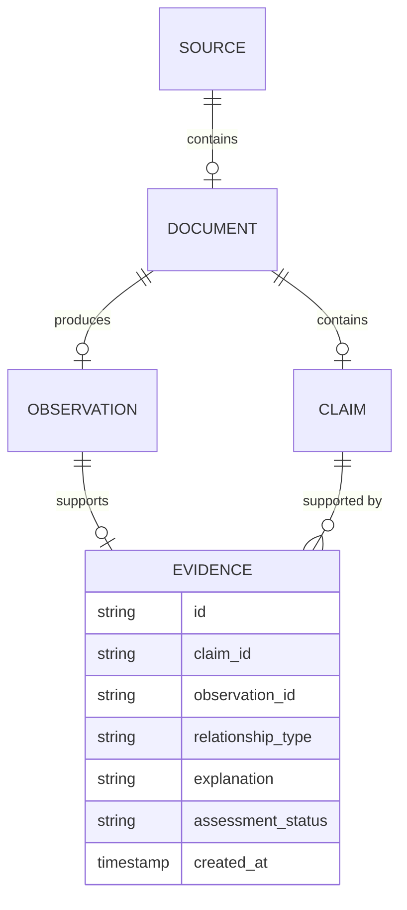

# Provenance Model

**Reality Engine — Provenance Model Document**
**Version:** 0.1.0
**Date:** November 1, 2026

This document defines the provenance model of Reality Engine. It defines how information enters the system and how its origins and dependencies remain traceable.

---

## 1. Provenance Definition

Provenance is the record of the origin of information. Every factual assertion must have traceable provenance.

**Example:**

```text
SOURCE A → DOCUMENT 1 → OBSERVATION → CLAIM X
```

Every claim must be traceable to:

1. The original source.
2. The specific source document.
3. The relevant passage (URL, page, paragraph).
4. The extraction timestamp.
5. The extraction model and version.
6. The extraction prompt version.
7. The validation status.

---

## 2. Provenance Fields

| Field | Description |
|---|---|
| Source ID | The source that published the claim |
| Document ID | The document containing the claim |
| Original URL | The original URL |
| Relevant passage | The passage that supports the claim |
| Page or paragraph location | The location within the document |
| Extraction timestamp | When the claim was extracted |
| Extraction model | The model used for extraction |
| Model version | The model version |
| Extraction prompt version | The prompt version |
| Validation status | Whether the claim passed validation |

---

## 3. Provenance Rules

1. **Every claim must be traceable to a source.**
2. **A claim without provenance may exist as an explicitly unverified hypothesis, but it must not enter the verified factual state.**
3. **Every evidence relationship must contain its own provenance.**
4. **Every evidence relationship, where applicable, must include an explanation of the inference.**
5. **The provenance chain must be preserved through revisions.**

---

## 3. Provenance Data Model



---

## 4. Provenance Examples

**Provenance record:**

```json
{
  "id": "prov_000001",
  "claim_id": "claim_000001",
  "source_id": "src_000001",
  "document_id": "doc_000001",
  "original_url": "https://example.com/article",
  "relevant_passage": "Inflation reached 3.2 percent.",
  "page": 4,
  "extraction_timestamp": "2026-10-16T10:00:00Z",
  "extraction_model": "model_v1",
  "model_version": "2.1.0",
  "prompt_version": "v3.0",
  "validation_status": "VALIDATED"
}
```

**Claim with provenance:**

```json
{
  "id": "claim_000001",
  "subject_id": "entity_000001",
  "predicate": "has_inflation_rate",
  "object_value": "3.2",
  "claim_type": "QUANTITATIVE",
  "domain_id": "economic",
  "valid_from": "2026-10-15T00:00:00Z",
  "valid_to": null,
  "recorded_at": "2026-10-16T10:00:00Z",
  "status": "SUPPORTED",
  "revision_number": 1,
  "provenance": "prov_000001"
}
```

---

## 5. Constraints

1. **Immutability:** Provenance records are immutable.
2. **Completeness:** Every claim must have provenance.
3. **Versioning:** Provenance is versioned.
4. **Consistency:** Provenance records must be consistent.

---

## 6. Summary

- Provenance is the record of the origin of information.
- Every claim must be traceable to a source.
- Provenance is preserved through revisions.
- The provenance chain is immutable.
