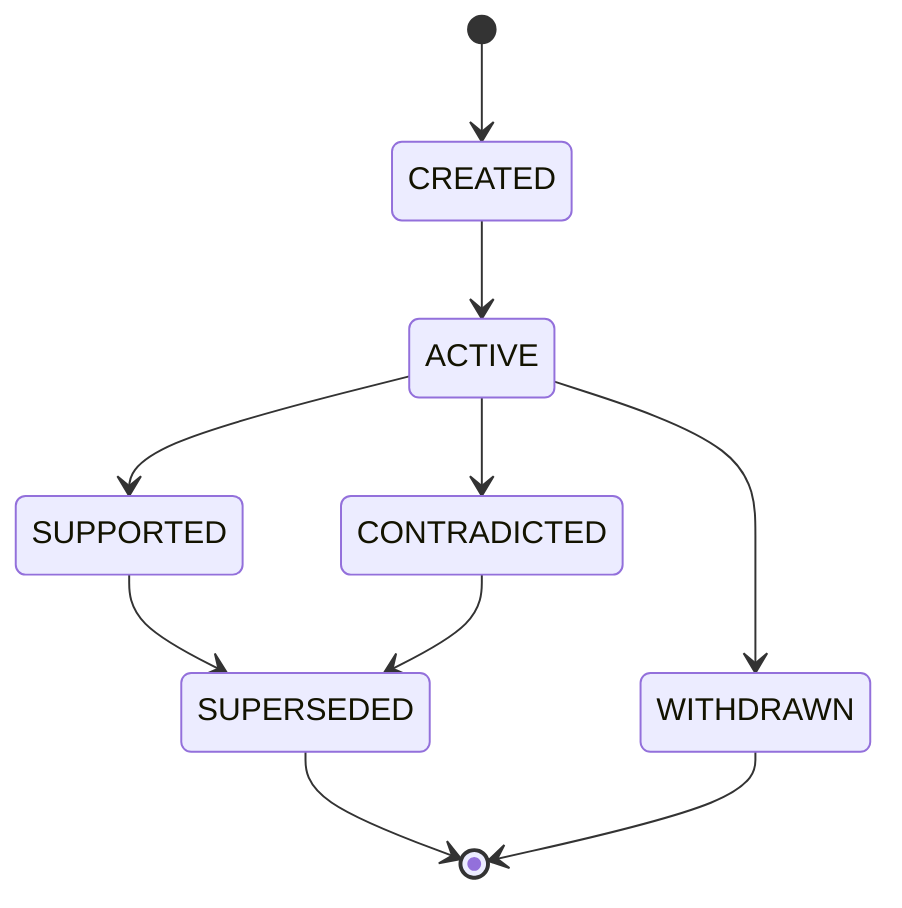

# Relationship Model

**Reality Engine — Relationship Model Document**
**Version:** 0.1.0
**Date:** November 1, 2026

This document defines the relationship model of Reality Engine. It defines all relationship types, their semantics, constraints, and temporal semantics.

---

## 1. Relationship Definition

A relationship connects entities, events, claims, or hypotheses. Relationships describe how objects are connected.

**Examples:**

- Country X `LOCATED_IN` Northeast Asia.
- Country X `AFFECTS` Country Y.
- Country X `CAUSES` Economic disruption in Country Y.
- Country X `SUPPORTS` Country Y.
- Country X `CONTRADICTS` Country Y.

---

## 2. Relationship Types

### 2.1 Structural Relationships

| Type | Meaning | Example |
|---|---|---|
| LOCATED_IN | Entity is located in a place | Country X LOCATED_IN Northeast Asia |
| MEMBER_OF | Entity is a member of a group | City X MEMBER_OF Country X |
| OWNS | Entity owns something | Country X OWNS Oil field Y |
| CONTROLS | Entity controls something | Country X CONTROLS Territory Y |
| PARTICIPATES_IN | Entity participates in an event | Country X PARTICIPATES_IN Election Y |

**Example:**

```json
{
  "id": "rel_000001",
  "source_entity_id": "entity_000001",
  "target_entity_id": "entity_000005",
  "relationship_type": "LOCATED_IN",
  "valid_from": "2026-10-15T00:00:00Z",
  "valid_to": null,
  "recorded_at": "2026-10-16T10:00:00Z",
  "evidence_status": "SUPPORTED",
  "created_at": "2026-10-16T10:00:00Z"
}
```

### 2.2 Attributive Relationships

| Type | Meaning | Example |
|---|---|---|
| ANNOUNCED | Entity announced something | Government ANNOUNCED Policy Y |
| AFFECTS | Entity affects something | Country X AFFECTS Country Y |
| SUPPORTS | Entity supports something | Country X SUPPORTS Organization Y |
| CONTRADICTS | Entity contradicts something | Source A CONTRADICTS Source B |

**Example:**

```json
{
  "id": "rel_000002",
  "source_entity_id": "entity_000002",
  "target_entity_id": "entity_000003",
  "relationship_type": "ANNOUNCED",
  "valid_from": "2026-10-15T00:00:00Z",
  "valid_to": null,
  "recorded_at": "2026-10-16T10:00:00Z",
  "evidence_status": "SUPPORTED",
  "created_at": "2026-10-16T10:00:00Z"
}
```

### 2.3 Temporal Relationships

| Type | Meaning | Example |
|---|---|---|
| PRECEDES | Entity/event precedes something | Event A PRECEDES Event B |
| FOLLOWS | Entity/event follows something | Event A FOLLOWS Event B |

**Example:**

```json
{
  "id": "rel_000003",
  "source_entity_id": "evt_000001",
  "target_entity_id": "evt_000002",
  "relationship_type": "PRECEDES",
  "valid_from": "2026-10-01T00:00:00Z",
  "valid_to": null,
  "recorded_at": "2026-10-16T10:00:00Z",
  "evidence_status": "SUPPORTED",
  "created_at": "2026-10-16T10:00:00Z"
}
```

### 2.4 Causal Relationships

| Type | Meaning | Example |
|---|---|---|
| DEPENDS_ON | Entity depends on something | Policy X DEPENDS_ON Economic condition Y |
| CORRELATES_WITH | Entity correlates with something | Country X CORRELATES_WITH Country Y |
| CAUSES | Entity causes something | Tariff X CAUSES Price increase Y |
| CAUSED_BY_HYPOTHESIS | Entity is caused by a hypothesis | Disconnect CORRELATED_WITH Energy shortage because of H1 |

**Example:**

```json
{
  "id": "rel_000004",
  "source_entity_id": "entity_000001",
  "target_entity_id": "entity_000002",
  "relationship_type": "CAUSES",
  "valid_from": "2026-10-10T00:00:00Z",
  "valid_to": null,
  "recorded_at": "2026-10-16T10:00:00Z",
  "evidence_status": "CAUSAL_HYPOTHESIS",
  "created_at": "2026-10-16T10:00:00Z"
}
```

### 2.5 Knowledge Relationships

| Type | Meaning | Example |
|---|---|---|
| PREDICTS | Entity predicts something | Hypothesis H PREDICTS Outcome Y |
| DERIVED_FROM | Entity is derived from something | Claim C DERIVED_FROM Observation O |

**Example:**

```json
{
  "id": "rel_000005",
  "source_entity_id": "hypothesis_000001",
  "target_entity_id": "forecast_000001",
  "relationship_type": "PREDICTS",
  "valid_from": "2026-10-15T00:00:00Z",
  "valid_to": null,
  "recorded_at": "2026-10-16T10:00:00Z",
  "evidence_status": "SUPPORTED",
  "created_at": "2026-10-16T10:00:00Z"
}
```

---

## 3. Relationship Fields

| Field | Type | Required | Description |
|---|---|---|---|
| id | string | Yes | Unique identifier |
| source_entity_id | string | Yes | Foreign key to source entity |
| target_entity_id | string | Yes | Foreign key to target entity |
| relationship_type | string | Yes | Type of relationship |
| valid_from | timestamp | Yes | When the relationship applies |
| valid_to | timestamp or null | No | When the relationship ceased to apply |
| recorded_at | timestamp | Yes | When the system recorded it |
| evidence_status | string | Yes | Evidence status |
| created_at | timestamp | Yes | Creation timestamp |

**evidence_status values:**

| Value | Meaning |
|---|---|
| SUPPORTED | Evidence supports the relationship |
| CONTRADICTED | Evidence contradicts the relationship |
| PARTIALLY_SUPPORTED | Some evidence supports, some challenges |
| UNSUPPORTED | No evidence supports the relationship |
| CONTESTED | Competing claims exist |

**Constraints:**

- `source_entity_id` must reference an existing Entity.
- `target_entity_id` must reference an existing Entity.
- `valid_from` must be less than or equal to `valid_to` (if `valid_to` is set).
- Causal relationships require stronger evidence and explicit methodological justification than ordinary associations.

---

## 4. Relationship State Machine



| State | Description |
|---|---|
| CREATED | The relationship has been created |
| ACTIVE | The relationship is active |
| SUPPORTED | Evidence supports the relationship |
| CONTRADICTED | Evidence contradicts the relationship |
| SUPERSEDED | Replaced by a newer version |
| WITHDRAWN | Explicitly withdrawn |

---

## 5. Relationship Examples

**Structural Relationship:**

```json
{
  "id": "rel_000001",
  "source_entity_id": "entity_000001",
  "target_entity_id": "entity_000005",
  "relationship_type": "LOCATED_IN",
  "valid_from": "2026-10-15T00:00:00Z",
  "valid_to": null,
  "recorded_at": "2026-10-16T10:00:00Z",
  "evidence_status": "SUPPORTED",
  "created_at": "2026-10-16T10:00:00Z"
}
```

**Attributive Relationship:**

```json
{
  "id": "rel_000002",
  "source_entity_id": "entity_000002",
  "target_entity_id": "entity_000003",
  "relationship_type": "ANNOUNCED",
  "valid_from": "2026-10-15T00:00:00Z",
  "valid_to": null,
  "recorded_at": "2026-10-16T10:00:00Z",
  "evidence_status": "SUPPORTED",
  "created_at": "2026-10-16T10:00:00Z"
}
```

**Causal Relationship:**

```json
{
  "id": "rel_000003",
  "source_entity_id": "entity_000001",
  "target_entity_id": "entity_000002",
  "relationship_type": "CAUSES",
  "valid_from": "2026-10-10T00:00:00Z",
  "valid_to": null,
  "recorded_at": "2026-10-16T10:00:00Z",
  "evidence_status": "CAUSAL_HYPOTHESIS",
  "created_at": "2026-10-16T10:00:00Z"
}
```

**Knowledge Relationship:**

```json
{
  "id": "rel_000004",
  "source_entity_id": "hypothesis_000001",
  "target_entity_id": "forecast_000001",
  "relationship_type": "PREDICTS",
  "valid_from": "2026-10-15T00:00:00Z",
  "valid_to": null,
  "recorded_at": "2026-10-16T10:00:00Z",
  "evidence_status": "SUPPORTED",
  "created_at": "2026-10-16T10:00:00Z"
}
```

---

## 6. Relationship Constraints

1. **Identity:** Each relationship must have a stable unique identifier.
2. **Temporal:** `valid_from` must be less than or equal to `valid_to` (if `valid_to` is set). All timestamps are in UTC.
3. **Identity:** `source_entity_id` and `target_entity_id` must reference existing entities.
4. **Causal:** Causal relationships require stronger evidence and explicit methodological justification than ordinary associations.
5. **Provenance:** Every relationship must contain its own provenance.
6. **Revision:** Relationships can be revised. Earlier versions are preserved.
7. **Domain:** A relationship can span multiple domains.

---

## 7. Relationship Ownership

| Relationship | Owner |
|---|---|
| Structural | Core (World State) |
| Attributive | Core (World State) |
| Temporal | Core (World State) |
| Causal | Core (World State) |
| Knowledge | Intelligence (Analyst) |

---

## 8. References

- ONTOLOGY.md — common ontology definitions
- ENTITY_MODEL.md — entity definitions
- EVENT_MODEL.md — event definitions
- CLAIM_MODEL.md — claim definitions
- BELIEF_REVISION.md — how relationships affect beliefs
- REVISION_STATE_MACHINE.md — how revisions interact with relationships
