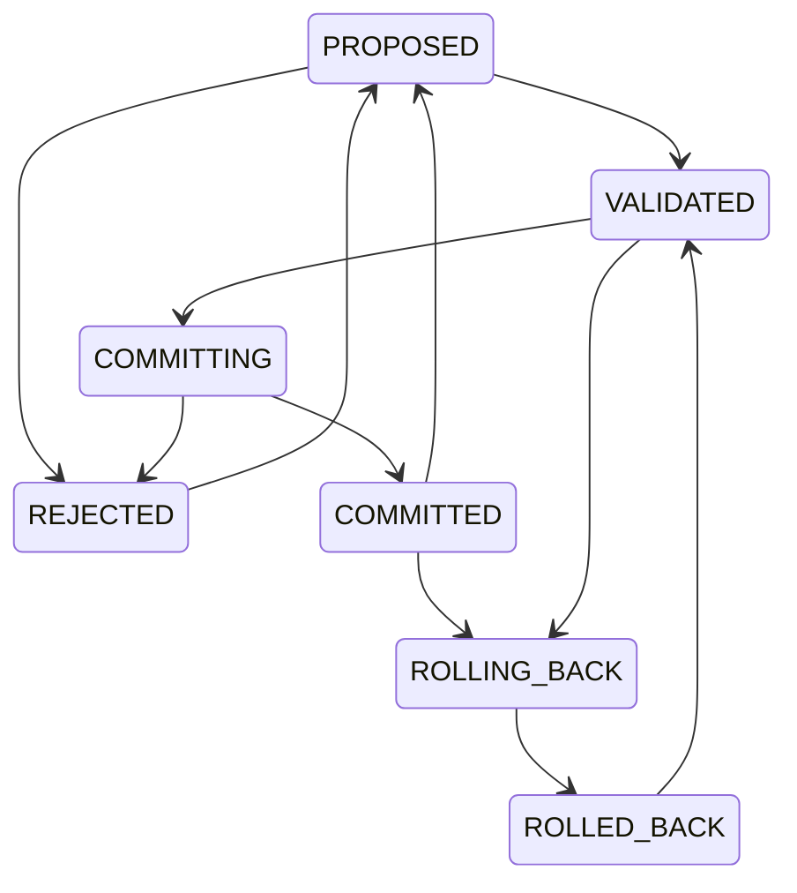

# Revision State Machine

**Reality Engine — Revision State Machine Document**
**Version:** 0.1.1
**Date:** November 1, 2026

This document defines the revision state machine, including revision triggers, revision proposals, revision operations, revision states, dependency traversal, conflict resolution, temporal consistency, validation, commit semantics, rollback and correction behavior, and audit requirements.

---

## 1. Revision State Machine

| State | Meaning |
|---|---|
| PROPOSED | The revision proposal has been generated. |
| VALIDATED | The proposal has been validated. |
| COMMITTING | The revision is being committed. |
| COMMITTED | The revision has been committed. |
| ROLLING_BACK | The revision is being rolled back. |
| ROLLED_BACK | The revision has been rolled back. |
| REJECTED | The proposal has been rejected. |

---

## 2. Revision Triggers

A revision may be triggered by:

- New evidence
- Corrected source data
- Source retraction
- New observation
- Entity identity correction
- Changed event date
- Contradictory measurement
- New scientific replication
- Invalidated hypothesis
- Changed domain schema
- Updated extraction or interpretation methodology

---

## 3. Revision Proposals

A revision proposal is a structured proposal to change the world model. It includes:

| Field | Description |
|---|---|
| proposal_id | Unique identifier |
| trigger_observation_id | The observation that triggered the revision |
| affected_records | Records affected by the proposal |
| prior_versions | Relevant prior versions |
| changes | The proposed changes |
| dependencies | Dependencies affected |
| evidence | Evidence references |
| temporal_consistency | Temporal consistency check |
| governance_check | Governance check |
| status | Status of the proposal |
| created_at | Creation timestamp |
| updated_at | Update timestamp |

---

## 4. Revision Operations

| Operation | Meaning |
|---|---|
| CREATE | Create a new entity, claim, or hypothesis |
| SUPPORT | Add supporting evidence |
| QUALIFY | Add qualifying conditions |
| CHALLENGE | Add contradictory evidence |
| RETRACT | Change a claim's assessment to WITHDRAWN; preserve claim record and history |
| REPLACE | Swap a claim for a corrected version |
| SUPERSEDE | Mark an older version as replaced |
| CORRECT_TEMPORAL_SCOPE | Fix the valid time range |
| REASSIGN_ENTITY | Change the subject entity |
| INVALIDATE_DEPENDENCY | Remove a dependency edge |
| REASSESS_HYPOTHESIS | Recalculate hypothesis status |

**Constraint:** Additional operations may be necessary. The state machine must support any operation that is needed.

---

## 5. Dependency Traversal

| Step | Action |
|---|---|
| 1 | Identify the directly affected claims. |
| 2 | Traverse the dependency graph to find downstream hypotheses. |
| 3 | Evaluate whether the supporting evidence remains valid. |
| 4 | Recalculate affected assessments. |
| 5 | Preserve unaffected assessments. |
| 6 | Record the revision. |

---

## 6. Conflict Resolution

| Conflict Type | Resolution |
|---|---|
| Temporal | Use bitemporal records to determine the correct valid time. |
| Provenance | Resolve by evaluating the specific authority dimensions for the claim domain; do not use a single universal authority score. |
| Evidence | Evaluate remaining evidence independently. |
| Dependency | Flag for reassessment without automatic reversal. |

**Constraint:** The system must not automatically reverse all downstream conclusions.

---

## 7. Temporal Consistency

Temporal consistency is enforced at three levels:

| Level | Enforcement |
|---|---|
| Database | Proper timestamp types, interval semantics |
| Application | Validation rules |
| Governance | Validated revisions |

**Constraints:**

- `valid_from` must be less than or equal to `valid_to` (if `valid_to` is set).
- `recorded_at` must be greater than or equal to `valid_from`.
- All timestamps are in UTC.
- Historical queries cannot silently incorporate future observations.

---

## 8. Validation

| Check | Description |
|---|---|
| Schema | Required fields, types, constraints |
| Provenance | Claim is traceable to a source passage |
| Temporal consistency | Valid time and recorded time are consistent |
| Source independence | Duplicates are deduplicated; shared origins flagged |
| Source quality | Source authority and reliability metadata present |
| Governance | Authorized actor, permitted operation |

---

## 9. Commit Semantics

| Property | Description |
|---|---|
| Atomicity | All changes are committed or none are. |
| Persistence | Committed changes are persisted. |
| Audit | All committed revisions are recorded. |
| Immutability | The historical record is not modified. |

---

## 10. Rollback and Correction Behavior

| Behavior | Description |
|---|---|
| Rollback | The revision is rolled back to the previous state. |
| Correction | A correction is recorded as a new record. |
| History | The historical record is preserved. |
| Audit | All rollback and correction events are recorded. |

---

## 11. Audit Requirements

All significant state transitions must produce audit events:

| Event | Description |
|---|---|
| REVISION_PROPOSED | A revision proposal has been generated |
| REVISION_VALIDATED | A revision proposal has been validated |
| REVISION_REJECTED | A revision proposal has been rejected |
| REVISION_COMMITTED | A revision proposal has been committed |
| REVISION_ROLLED_BACK | A revision has been rolled back |

**Constraint:** The audit ledger is append-only.

---

## 12. Summary

- The revision state machine has eight states.
- Revisions can be triggered by nine events.
- Revisions can be proposed, validated, committed, or rejected.
- Dependency traversal is explicit and deterministic.
- Conflict resolution uses bitemporal records, evidence, and independence.
- Temporal consistency is enforced at three levels.
- Commits are atomic and audited.
- Rollbacks and corrections are recorded.
- The audit ledger is append-only.

---

## 13. References

- ONTOLOGY.md — common ontology definitions
- TEMPORAL_MODEL.md — bitemporal semantics
- HYPOTHESIS_MODEL.md — hypothesis definitions
- FORECAST_MODEL.md — forecast definitions
- REVISION_MODEL.md — revision model
- DEPENDENCY_GRAPH.md — dependency graph
- REVISION_VALIDATION.md — revision validation
- REVISION_TRANSACTION_MODEL.md — revision transaction model
